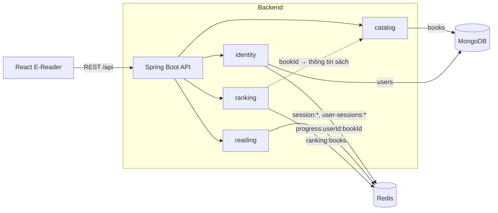
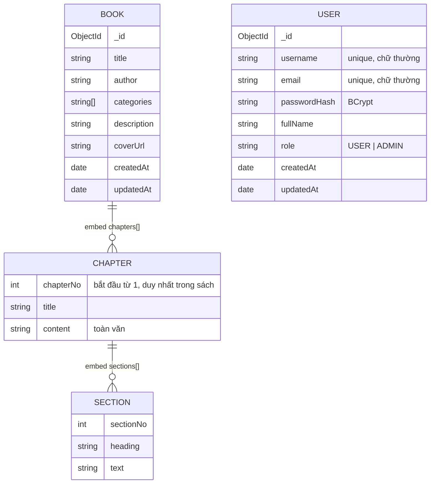

# Kiến trúc & thiết kế CSDL

> Phụ trách: Vũ (SV1 – Data Architect). Phần Redis cho tiến trình đọc và bảng xếp hạng chốt cùng Đạt.
> Nguồn sự thật của schema MongoDB nằm ở `backend/src/main/resources/mongo/*.schema.json`; backend áp validator và tạo index mỗi lần khởi động, nên tài liệu này và database luôn khớp nhau.

## 1. Giải trình Polyglot Persistence (1.0đ)

### 1.1. Bài toán có ba loại dữ liệu khác nhau
| Dữ liệu | Đặc điểm truy cập | Yêu cầu chính |
|---|---|---|
| Sách → chương → mục, tài khoản độc giả | Ghi ít, đọc nhiều; văn bản lớn; cấu trúc lồng nhau; cần tìm kiếm | Bền vững, schema linh hoạt, truy vấn và index |
| Tiến trình đọc dở (`chapter, page, line`) | Ghi liên tục mỗi lần lật trang, đọc khi mở sách | Độ trễ thấp, ghi đè từng field, chịu tải ghi cao |
| Lượt đọc và bảng xếp hạng | Tăng điểm mỗi lần mở chương, đọc Top N liên tục | Luôn có thứ tự, cập nhật thời gian thực |

Không có một CSDL nào tối ưu cho cả ba, nên hệ thống dùng **MongoDB cho dữ liệu nội dung** và **Redis cho dữ liệu trạng thái/tạm**.

### 1.2. Vì sao MongoDB lưu nội dung sách
- **Document model khớp cấu trúc sách.** Một cuốn sách là một cây `book → chapters[] → sections[]`. MongoDB lưu nguyên cây trong một document, đọc chi tiết sách hay một chương chỉ cần một truy vấn, không JOIN như mô hình quan hệ (bảng `books`, `chapters`, `sections`).
- **Schema linh hoạt nhưng vẫn kiểm soát được.** Sách khác nhau có số chương, số mục, metadata khác nhau. `$jsonSchema` validator vẫn đảm bảo các trường bắt buộc và kiểu dữ liệu (xem mục 2).
- **Truy vấn phong phú trên văn bản.** Text index trên `title`, `author` để tìm kiếm; multikey index trên `categories` để lọc; projection để không trả toàn văn khi chỉ cần danh sách.
- **Cập nhật một phần của mảng lồng nhau.** `$push` thêm chương, toán tử vị trí `chapters.$` sửa chương, `$pull` xóa chương, không phải ghi lại cả document.
- **Bền vững.** Dữ liệu nội dung là tài sản lâu dài, cần journaling và backup; MongoDB ghi xuống đĩa theo mặc định.

### 1.3. Vì sao Redis lưu tiến trình đọc và bảng xếp hạng
- **Tiến trình đọc – Redis Hash.** Mỗi lần lật trang là một lần ghi. `HSET progress:{userId}:{bookId} page 30` chỉ ghi đè field cần đổi, chạy trong bộ nhớ với độ trễ dưới 1 ms. `HGETALL` trả toàn bộ tiến trình trong một lệnh khi mở lại sách. Nếu dùng MongoDB, mỗi lần lật trang là một update có ghi journal, tạo tải ghi lớn lên CSDL đang phục vụ nội dung.
- **Bảng xếp hạng – Redis Sorted Set.** `ZINCRBY ranking:books 1 {bookId}` tăng điểm và Redis tự giữ thứ tự (O(log N)); `ZREVRANGE ranking:books 0 9 WITHSCORES` lấy Top 10 ngay. Trong MongoDB phải `$inc` một bộ đếm rồi `sort` (cần index trên bộ đếm, index bị cập nhật liên tục) hoặc chạy aggregation mỗi lần xem BXH.
- **Phiên đăng nhập – Redis String có TTL.** Phiên là dữ liệu tạm có hạn dùng; `SET ... EX` tự hết hạn, không cần job dọn dẹp như khi lưu trong MongoDB.

### 1.4. So sánh với dùng một CSDL duy nhất
| Tiêu chí | Chỉ MongoDB | Chỉ Redis | MongoDB + Redis (chọn) |
|---|---|---|---|
| Lưu cây sách/chương/mục | Tốt (document lồng nhau) | Kém: phải tự chia key, không có truy vấn/index phụ, toàn bộ văn bản chiếm RAM | Tốt |
| Tìm kiếm, lọc thể loại | Text index, multikey index | Phải tự dựng index bằng Set | Tốt |
| Ghi tiến trình mỗi lần lật trang | Được nhưng tốn I/O đĩa, tăng tải | Rất tốt (bộ nhớ, ghi đè field) | Rất tốt |
| BXH thời gian thực | `$inc` + `sort`/aggregation, chậm dần khi nhiều lượt đọc | `ZINCRBY`/`ZREVRANGE` sẵn có | Rất tốt |
| Chi phí vận hành | 1 hệ thống | 1 hệ thống, nhưng RAM lớn | 2 hệ thống, mỗi hệ thống làm đúng việc của nó |

### 1.5. Luồng dữ liệu giữa hai hệ thống



1. **Duyệt và mở sách:** React gọi `GET /api/books`, `GET /api/books/{bookId}` → catalog đọc MongoDB (đã bỏ toàn văn bằng projection).
2. **Mở chương:** React gọi `GET /api/books/{bookId}/chapters/{chapterNo}` (MongoDB, `$elemMatch` chỉ lấy một chương) và `POST /api/books/{bookId}/read` → `ZINCRBY` trên Redis.
3. **Lật trang / đóng sách:** `PUT /api/progress/{userId}/{bookId}` → `HSET` trên Redis.
4. **Mở lại sách:** `GET /api/progress/{userId}/{bookId}` → `HGETALL` trên Redis, giao diện cuộn đến đúng trang.
5. **Xem BXH:** `GET /api/ranking?top=10` → `ZREVRANGE` lấy danh sách `bookId`, sau đó `GET /api/books/batch?ids=...` ghép tiêu đề, tác giả từ MongoDB.

**Liên kết giữa hai hệ thống chỉ qua ID:** Redis chỉ chứa `bookId`, `userId` (chuỗi ObjectId của MongoDB), không sao chép tiêu đề hay nội dung sách. Nhờ vậy sửa thông tin sách trong MongoDB không cần đồng bộ sang Redis.

### 1.6. Đánh đổi và cách xử lý
| Rủi ro | Ảnh hưởng | Cách xử lý trong đồ án |
|---|---|---|
| Redis mất dữ liệu khi tắt đột ngột | Mất tiến trình đọc hoặc lượt đọc gần nhất | Docker Compose bật AOF (`--appendonly yes`), mất tối đa khoảng 1 giây ghi. Tiến trình và lượt đọc là dữ liệu có thể chấp nhận mất một phần. |
| Không có transaction giữa MongoDB và Redis | Xóa sách trong MongoDB, `bookId` vẫn còn trong `ranking:books` | Catalog `GET /api/books/batch` bỏ qua id không tồn tại nên BXH không hiển thị sách đã xóa; ranking có thể `ZREM` khi gặp id mồ côi. |
| Nhất quán cuối (eventual) | BXH có thể lệch vài lượt so với thực tế khi request lỗi | Chấp nhận được với BXH "thịnh hành"; không dùng cho dữ liệu cần chính xác tuyệt đối. |
| Vận hành 2 hệ thống | Thêm cấu hình, giám sát | Docker Compose dựng sẵn cả hai, kèm Compass/Mongo Express và Redis Insight. |
| Dữ liệu Redis bị giới hạn bởi RAM | Không lưu được toàn văn | Chỉ lưu dữ liệu nhỏ (vài field mỗi Hash, một ZSET), nội dung lớn ở MongoDB. |

## 2. Thiết kế MongoDB (1.5đ – phần 1)

Database: `digital_library`. Hai collection: `books`, `users`.

### 2.1. Document model



Ví dụ document `books`:
```json
{
  "_id": { "$oid": "6ad9aafea64520f313150512" },
  "title": "Dế Mèn phiêu lưu ký",
  "author": "Tô Hoài",
  "categories": ["Thiếu nhi", "Văn học"],
  "description": "Truyện đồng thoại",
  "createdAt": { "$date": "2026-10-22T06:19:42.151Z" },
  "updatedAt": { "$date": "2026-10-22T06:19:42.423Z" },
  "chapters": [
    {
      "chapterNo": 1,
      "title": "Tôi sống độc lập từ thuở bé",
      "content": "Bởi tôi ăn uống điều độ...",
      "sections": [ { "sectionNo": 1, "heading": "Mở đầu", "text": "..." } ]
    }
  ]
}
```

### 2.2. Vì sao embed chương và mục trong sách
- **Luôn đọc cùng nhau:** chương không tồn tại độc lập ngoài sách; mở sách cần mục lục, mở chương cần biết thuộc sách nào.
- **Số lượng có giới hạn:** mỗi sách 5–10 chương (validator cho phép tối đa 200). Một chương văn bản thường 20–100 KB, nên một sách 10 chương khoảng 1 MB, xa giới hạn **16 MB/document** của MongoDB.
- **Cập nhật nguyên tử:** thêm/sửa/xóa chương là một thao tác trên một document, MongoDB đảm bảo nguyên tử ở mức document mà không cần transaction.
- **Truy xuất một phần:** dù embed, API không trả toàn bộ văn bản. Danh sách loại `chapters.content` và `chapters.sections`; chi tiết chỉ giữ mục lục; đọc chương dùng projection `$elemMatch` lấy đúng một chương.
- **Khi nào phải tách:** nếu một sách có hàng trăm chương dài vượt 16 MB, tách `chapters` thành collection riêng tham chiếu `bookId`. Quy mô đồ án không cần.

`users` là collection riêng vì độc giả tồn tại độc lập với sách và quan hệ với sách (đang đọc, lượt đọc) nằm ở Redis.

### 2.3. JSON Schema validator
Áp bằng `collMod` với `validationLevel: "strict"`, `validationAction: "error"`. Document sai schema bị MongoDB từ chối (`Document failed validation`), kể cả khi ghi trực tiếp bằng Compass hoặc script seed.

`books` ([books.schema.json](../backend/src/main/resources/mongo/books.schema.json)):
```json
{
  "$jsonSchema": {
    "bsonType": "object",
    "required": ["title", "author", "categories", "chapters", "createdAt"],
    "properties": {
      "title": { "bsonType": "string", "minLength": 1, "maxLength": 300 },
      "author": { "bsonType": "string", "minLength": 1, "maxLength": 200 },
      "categories": { "bsonType": "array", "maxItems": 20, "uniqueItems": true,
                      "items": { "bsonType": "string", "minLength": 1, "maxLength": 100 } },
      "description": { "bsonType": "string", "maxLength": 5000 },
      "coverUrl": { "bsonType": "string", "maxLength": 2000 },
      "createdAt": { "bsonType": "date" },
      "updatedAt": { "bsonType": "date" },
      "chapters": {
        "bsonType": "array", "maxItems": 200,
        "items": {
          "bsonType": "object",
          "required": ["chapterNo", "title"],
          "properties": {
            "chapterNo": { "bsonType": ["int", "long"], "minimum": 1 },
            "title": { "bsonType": "string", "minLength": 1, "maxLength": 300 },
            "content": { "bsonType": "string" },
            "sections": {
              "bsonType": "array",
              "items": {
                "bsonType": "object",
                "required": ["sectionNo", "heading", "text"],
                "properties": {
                  "sectionNo": { "bsonType": ["int", "long"], "minimum": 1 },
                  "heading": { "bsonType": "string", "maxLength": 300 },
                  "text": { "bsonType": "string" }
                }
              }
            }
          }
        }
      }
    }
  }
}
```

`users` ([users.schema.json](../backend/src/main/resources/mongo/users.schema.json)):
```json
{
  "$jsonSchema": {
    "bsonType": "object",
    "required": ["username", "email", "passwordHash", "role", "createdAt"],
    "properties": {
      "username": { "bsonType": "string", "pattern": "^[a-z0-9_.]{3,32}$" },
      "email": { "bsonType": "string", "pattern": "^[^@\\s]+@[^@\\s]+\\.[^@\\s]+$", "maxLength": 254 },
      "passwordHash": { "bsonType": "string", "minLength": 20 },
      "fullName": { "bsonType": "string", "maxLength": 100 },
      "role": { "enum": ["USER", "ADMIN"] },
      "createdAt": { "bsonType": "date" },
      "updatedAt": { "bsonType": "date" }
    }
  }
}
```

**Lưu ý cho script seed:** `chapterNo`, `sectionNo` phải là số nguyên (`int` trong Python, `NumberInt(1)` trong mongosh vì mongosh mặc định ghi số thực `double`); `createdAt` phải là kiểu `date`; `categories` và `chapters` bắt buộc có (được phép là mảng rỗng). Spring Data thêm trường `_class` vào document, validator cho phép trường này.

### 2.4. Index
| Collection | Tên index | Định nghĩa | Phục vụ |
|---|---|---|---|
| books | `tx_books_title_author` | text `{title: 10, author: 5}`, `default_language: "none"` | `GET /api/books?q=` tìm theo tiêu đề/tác giả, xếp theo `textScore`. `none` tắt stemming tiếng Anh; text index v3 không phân biệt dấu nên "de men" khớp "Dế Mèn". |
| books | `ix_books_categories` | `{categories: 1}` (multikey) | `GET /api/books?category=`, `GET /api/books/categories` |
| books | `ix_books_createdAt` | `{createdAt: -1}` | Danh sách mặc định, sách mới trước |
| users | `ux_users_username` | `{username: 1}` unique | Đăng nhập, chống trùng tên |
| users | `ux_users_email` | `{email: 1}` unique | Chống trùng email |

### 2.5. Thao tác MongoDB chính của API
| Nghiệp vụ | Lệnh MongoDB |
|---|---|
| Danh sách có phân trang, lọc | `find({categories: c}).sort({createdAt: -1}).skip(p*s).limit(s)` + projection loại `chapters.content`, `chapters.sections`, `chapters.title` |
| Tìm kiếm | `find({$text: {$search: q}}).sort({score: {$meta: "textScore"}})` |
| Đọc một chương | `findOne({_id}, {title: 1, chapters: {$elemMatch: {chapterNo: n}}})` |
| Thêm chương | `updateOne({_id, "chapters.chapterNo": {$ne: n}}, {$push: {chapters: {$each: [c], $sort: {chapterNo: 1}}}})` – điều kiện `$ne` chống trùng số chương, `$sort` giữ mảng theo thứ tự |
| Sửa chương | `updateOne({_id, "chapters.chapterNo": n}, {$set: {"chapters.$": c}})` |
| Xóa chương | `updateOne({_id, "chapters.chapterNo": n}, {$pull: {chapters: {chapterNo: n}}})` |
| Sửa thông tin sách | `findOneAndUpdate({_id}, {$set: {...}}, {returnNewDocument: true})` – không ghi lại mảng chương |

## 3. Thiết kế Redis (1.5đ – phần 2)

### 3.1. Quy ước key
- Dạng `domain:định-danh`, phân cách bằng `:` để Redis Insight nhóm key theo thư mục.
- Định danh là chuỗi ObjectId của MongoDB (`userId`, `bookId`), không lưu thông tin trùng lặp với MongoDB.

| Key | Kiểu | Ví dụ giá trị | Phụ trách | TTL | Mục đích |
|---|---|---|---|---|---|
| `progress:{userId}:{bookId}` | Hash | `chapter=3, page=30, line=0, updatedAt=2026-10-22T06:00:00Z` | Đạt | Không đặt trong bản demo | Tiến trình đọc dở |
| `ranking:books` | ZSET | member=`bookId`, score=số lần mở chương | Đạt | Không | BXH sách thịnh hành |
| `session:{sha256(token)}` | String | `userId` | Vũ | `app.auth.session-ttl`, mặc định 7 ngày | Phiên đăng nhập |
| `user-sessions:{userId}` | Set | các `sha256(token)` | Vũ | Bằng TTL phiên, gia hạn khi đăng nhập | Thu hồi mọi phiên khi đổi mật khẩu/xóa tài khoản |

`chapter` và `page` bắt đầu từ 1, `line` từ 0, `updatedAt` theo ISO 8601 UTC (giống `docs/SHARED.md`).

### 3.2. Lệnh chính
```redis
# Tiến trình đọc
HSET progress:6ad9aae8a64520f313150511:6ad9aafea64520f313150512 chapter 3 page 30 line 0 updatedAt 2026-10-22T06:00:00Z
HGETALL progress:6ad9aae8a64520f313150511:6ad9aafea64520f313150512

# Bảng xếp hạng
ZINCRBY ranking:books 1 6ad9aafea64520f313150512
ZREVRANGE ranking:books 0 9 WITHSCORES
ZREVRANK ranking:books 6ad9aafea64520f313150512

# Phiên đăng nhập
SET session:<sha256> 6ad9aae8a64520f313150511 EX 604800
SADD user-sessions:6ad9aae8a64520f313150511 <sha256>
```

### 3.3. Đồng bộ với MongoDB
- Bản demo **không đồng bộ ngược** tiến trình/lượt đọc về MongoDB; Redis bật AOF để giữ dữ liệu khi khởi động lại.
- Hướng mở rộng nếu cần lưu lâu dài: job định kỳ đọc `ranking:books` và `SCAN progress:*` rồi `bulkWrite` vào collection `reading_history` (write-behind).
- Khi xóa sách, ranking nên `ZREM ranking:books {bookId}`; nếu chưa làm, `GET /api/books/batch` đã bỏ qua id không còn tồn tại.

### 3.4. Phiên đăng nhập
- `POST /api/auth/login` kiểm tra BCrypt trong MongoDB rồi sinh token ngẫu nhiên 256 bit, lưu **băm SHA-256** của token vào Redis. Người xem Redis Insight không lấy được token dùng được.
- Mỗi request có `@Authenticated`/`@AdminOnly` tra Redis lấy `userId`, rồi đọc user trong MongoDB để có `role` hiện tại. Tài khoản bị xóa hoặc đổi quyền có hiệu lực ngay.
- Đổi mật khẩu hoặc xóa tài khoản thu hồi mọi phiên qua `user-sessions:{userId}`; đăng xuất xóa phiên hiện tại.

## 4. Kết quả đo hiệu năng
_Chờ số liệu đo Redis vs MongoDB từ Đạt và Sơn (Phase 2)._
