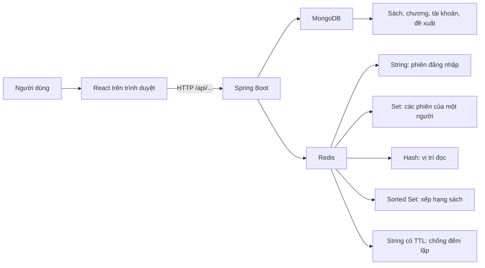
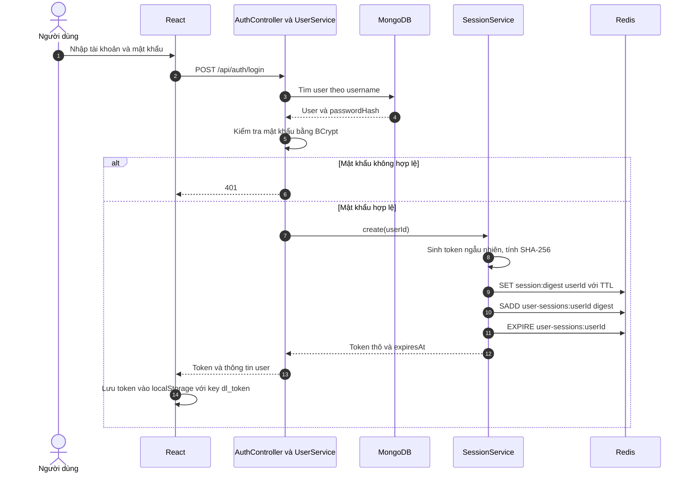
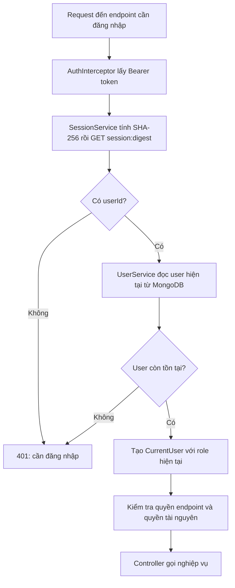
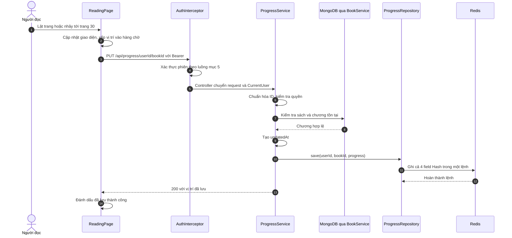
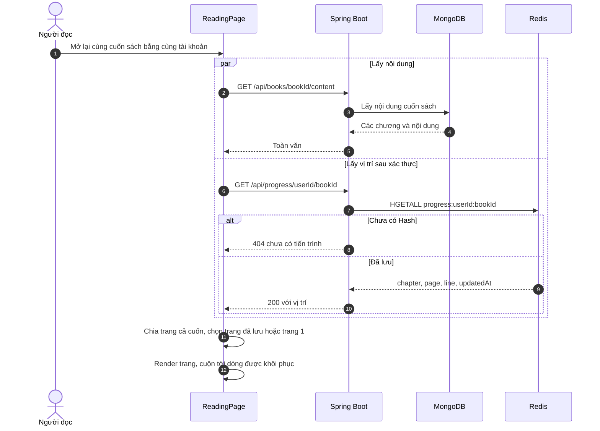
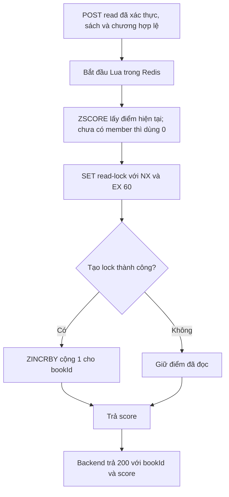
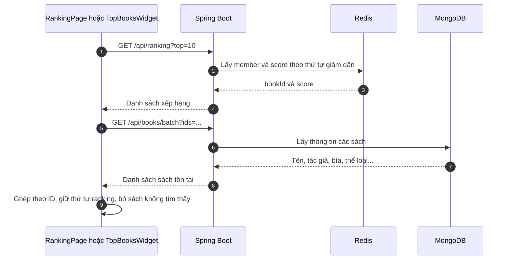
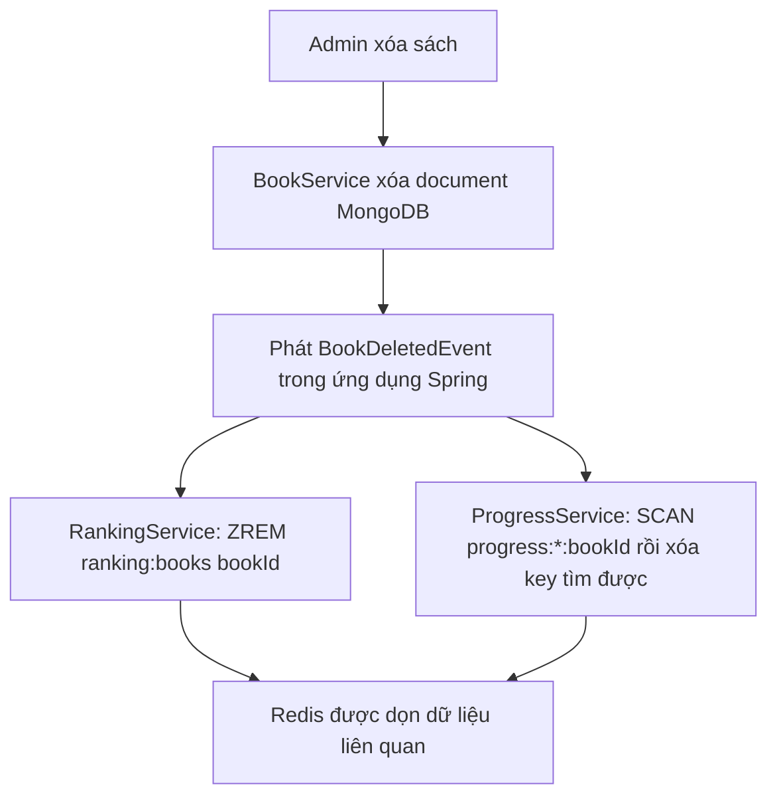

# Học Redis qua project Thư viện số

> Dành cho người mới học NoSQL và muốn hiểu, tự chạy thử, rồi giải thích được chính project này.
>
> Đối chiếu mã nguồn ngày **29/10/2026**. Các luồng dưới đây mô tả cách hệ thống hiện tại hoạt động; phần “mở rộng” được ghi riêng. Ví dụ `u1`, `b1` là ID minh họa trong Redis, không phải ID hợp lệ để gọi API của project.

## Cách học tài liệu này

Bạn có thể chia thành ba buổi:

| Buổi | Đọc và thực hành | Kết quả cần đạt |
|---|---|---|
| 1 | Mục 1–4, bài thực hành A–C | Phân biệt được key, value, String, Hash, Set, Sorted Set và TTL |
| 2 | Mục 5–8, bài thực hành D | Kể lại được một lần đăng nhập, lưu trang và tăng lượt đọc |
| 3 | Mục 9–13 | Tự xem Redis thật, giải thích tính nguyên tử, persistence và giới hạn thiết kế |

Sơ đồ dùng cú pháp **Mermaid**. GitHub có thể hiển thị trực tiếp; nếu trình xem Markdown chỉ hiện mã, dùng trình xem có hỗ trợ Mermaid. Tên API, tên khóa và các bước đánh số vẫn đọc được khi không render sơ đồ.

### Mục lục

1. [Redis giải quyết việc gì trong project?](#bai-1)
2. [Nền tảng: key, value, kiểu dữ liệu](#bai-2)
3. [Bản đồ khóa Redis của hệ thống](#bai-3)
4. [TTL: dữ liệu tồn tại bao lâu?](#bai-4)
5. [Luồng thực tế: đăng nhập và xác thực](#bai-5)
6. [Luồng thực tế: lưu và mở lại vị trí đọc](#bai-6)
7. [Luồng thực tế: bảng xếp hạng và chống đếm lặp](#bai-7)
8. [Luồng thực tế: ghép tên sách và cập nhật giao diện](#bai-8)
9. [Spring Boot giao tiếp với Redis thế nào?](#bai-9)
10. [Xóa dữ liệu liên quan và tính nhất quán](#bai-10)
11. [Redis lưu trong RAM: tắt đi có mất không?](#bai-11)
12. [Thực hành bằng redis-cli và Redis Insight](#bai-12)
13. [Câu hỏi tự kiểm tra, lỗi thường gặp và hướng mở rộng](#bai-13)
14. [Bản đồ mã nguồn và tài liệu đọc thêm](#bai-14)

<a id="bai-1"></a>

## 1. Redis giải quyết việc gì trong project?

Hãy tưởng tượng thư viện có hai nơi ghi chép:

- **Kho hồ sơ:** sách, nội dung chương, tài khoản, đề xuất bổ sung sách. Project lưu những document này trong **MongoDB**.
- **Bàn làm việc cập nhật liên tục:** ai đang đăng nhập, người đọc dừng ở đâu, sách nào đang có nhiều lượt mở chương. Project dùng **Redis** cho các trạng thái này.

Redis là một hệ quản trị dữ liệu có các cấu trúc như String, Hash, Set và Sorted Set. Dữ liệu được thao tác trong bộ nhớ, nhưng có thể cấu hình ghi xuống đĩa. Trong project, lựa chọn Redis còn giúp diễn đạt bài toán trực tiếp: vị trí đọc là một Hash; bảng xếp hạng là một Sorted Set.



**Trình duyệt gọi backend; backend mới truy cập Redis.** Người dùng không gửi lệnh `HSET` trực tiếp từ giao diện đến Redis.

### Redis ở đây có phải chỉ là cache?

Cache là bản sao có thể dựng lại từ nguồn dữ liệu khác. Với luồng hiện tại:

| Dữ liệu | Nơi giữ dữ liệu nghiệp vụ | Nếu dữ liệu Redis bị mất hoàn toàn |
|---|---|---|
| Tài khoản, sách | MongoDB | Document MongoDB vẫn còn |
| Phiên đăng nhập | Redis | Token cũ không còn tra ra tài khoản; cần đăng nhập lại |
| Vị trí đọc | Redis | Không có bản tiến trình tương ứng được luồng hiện tại ghi song song vào MongoDB |
| Điểm bảng xếp hạng | Redis | Lượt đọc tiếp theo có thể tạo điểm mới, nhưng không khôi phục được tổng lịch sử cũ từ collection sách |

Vì vậy, **tiến trình và điểm xếp hạng trong project là trạng thái nghiệp vụ được lưu ở Redis**. Khi thiết kế vận hành, cần quan tâm đến khả năng lưu bền của chúng.

**Tự hỏi:** Vì sao việc tài khoản vẫn tồn tại trong MongoDB không đồng nghĩa với token cũ vẫn đăng nhập được?

<a id="bai-2"></a>

## 2. Nền tảng: key, value, kiểu dữ liệu

### 2.1. Key và value

Ví dụ:

```text
key   = progress:u1:b1
value = một Hash chứa chapter, page, line, updatedAt
```

`key` là tên để tìm dữ liệu. `value` là dữ liệu nằm dưới tên đó. **Kiểu dữ liệu thuộc về value**, không phải được quyết định bởi chữ trong tên key.

Dấu `:` chỉ là quy ước giúp tên dễ đọc. `progress:u1:b1` là **một key hoàn chỉnh**, không phải thư mục `progress` chứa thư mục `u1`.

Redis có các database logic được chọn bằng chỉ số như `0`, `1`. Một Redis server có thể có nhiều database logic; chúng không phải nhiều container. Các lệnh thực hành dưới đây chọn DB `0`; nếu `REDIS_URL` của backend chọn DB khác thì phải chọn đúng DB đó khi quan sát.

### 2.2. Bốn kiểu dữ liệu cần học trước

| Kiểu | Hình dung | Ví dụ trong project | Nhóm lệnh |
|---|---|---|---|
| **String** | Một giá trị tại một key | `session:...` chứa `userId`; `read-lock:...` chứa `1` | `SET`, `GET`, `GETDEL` |
| **Hash** | Một nhóm field → value | `progress:u1:b1` chứa trang, chương, dòng | `HSET`, `HGET`, `HGETALL` |
| **Set** | Tập các phần tử không trùng | `user-sessions:u1` chứa các digest phiên | `SADD`, `SMEMBERS`, `SREM` |
| **Sorted Set / ZSET** | Tập member, mỗi member có điểm | `ranking:books`: member là `bookId`, score là lượt đọc được tính | `ZINCRBY`, `ZSCORE`, `ZRANGE`, `ZREM` |

Đối chiếu khái niệm kiểu dữ liệu: [Redis data types](https://redis.io/docs/latest/develop/data-types/).

### 2.3. Hai lớp key trong Hash

```text
Redis key: progress:u1:b1
    ├── field chapter   → "3"
    ├── field page      → "30"
    ├── field line      → "14"
    └── field updatedAt → "2026-10-29T07:00:00Z"
```

Ở đây có **1 Redis key và 4 field**, không phải 4 Redis key. Trong code, số nguyên được đổi thành chuỗi trước khi ghi; khi đọc, backend dùng `Integer.parseInt(...)` để dựng lại DTO.

### 2.4. Một key không đồng thời là Hash và String

Ví dụ `HGETALL` cần key chứa Hash. Nếu key đó đang chứa String, Redis trả lỗi `WRONGTYPE`. Vì vậy, khi tìm hiểu dữ liệu, nên xem `TYPE ten-key` trước rồi chọn lệnh phù hợp.

<a id="bai-3"></a>

## 3. Bản đồ khóa Redis của hệ thống

Trong bảng, `{userId}` là chỗ cần thay bằng ID thật. Dấu ngoặc nhọn là ký hiệu trong tài liệu; code nối chuỗi không thêm chúng vào tên key.

| Mẫu key | Kiểu | Nội dung | Vòng đời theo code |
|---|---|---|---|
| `session:{sha256(token)}` | String | `userId` | Có TTL; mặc định 7 ngày |
| `user-sessions:{userId}` | Set | Các digest của những token đã cấp | Được đặt/gia hạn TTL khi tạo phiên |
| `progress:{userId}:{bookId}` | Hash | `chapter`, `page`, `line`, `updatedAt` | Luồng ghi không đặt TTL |
| `ranking:books` | ZSET | `bookId` → `score` | Luồng ghi không đặt TTL |
| `read-lock:{userId}:{bookId}:{chapterNo}` | String | `"1"` | TTL 60 giây khi tạo mới thành công |

Ví dụ minh họa:

```text
session:abc123...          → "u1"
user-sessions:u1           → { "abc123...", "def456..." }
progress:u1:b1             → { chapter: "3", page: "30", line: "14", ... }
ranking:books              → { b1: 12, b2: 8, b3: 20 }
read-lock:u1:b1:3          → "1", còn khoảng 60 giây
```

### Vì sao thiết kế tên key như vậy?

- **Progress cần cả user và sách:** hai người đọc cùng sách vẫn có vị trí riêng; một người đọc hai sách cũng có hai vị trí riêng.
- **Ranking cần một ZSET chung:** Redis so sánh điểm giữa các sách trong cùng một tập.
- **Read-lock cần thêm chương:** mở chương khác được tính riêng, dù vẫn là cùng user và cùng sách.
- **Session dùng digest token:** backend tra token qua SHA-256; không đặt token thô vào tên key.

ID ObjectId hợp lệ được service progress/ranking chuẩn hóa về dạng hex chữ thường. Điều này tránh việc cùng một ID viết HOA và thường tạo ra hai key/member mới khác nhau. Đây là quy tắc của ứng dụng; Redis vốn coi hai chuỗi khác nhau là hai tên khác nhau. Code hiện tại không tự gộp dữ liệu legacy đã phân mảnh trước đó.

**Căn cứ:** [SessionService](../backend/src/main/java/vn/edu/huit/digitallibrary/identity/service/SessionService.java), [ProgressRepository](../backend/src/main/java/vn/edu/huit/digitallibrary/reading/repository/ProgressRepository.java), [RankingRepository](../backend/src/main/java/vn/edu/huit/digitallibrary/ranking/repository/RankingRepository.java).

<a id="bai-4"></a>

## 4. TTL: dữ liệu tồn tại bao lâu?

**TTL — Time To Live** là thời gian còn lại trước khi key hết hạn. Ví dụ:

```redis
SET learning:redis:ticket "u1" EX 60
TTL learning:redis:ticket
```

Lệnh đầu tạo String có thời hạn 60 giây. Kết quả `TTL` giảm theo thời gian:

| Kết quả | Ý nghĩa |
|---|---|
| Số không âm | Số giây còn lại; key sắp hết hạn có thể trả `0` |
| `-1` | Key tồn tại nhưng không có thời hạn hết hạn |
| `-2` | Key không tồn tại, bao gồm trường hợp đã hết hạn |

Nguồn: [TTL](https://redis.io/docs/latest/commands/ttl/).

### Ba chính sách khác nhau trong cùng project

1. **Session:** hết hạn để token không tồn tại vô thời hạn. Mặc định `7d` trong `app.auth.session-ttl`; có thể đổi bằng `AUTH_SESSION_TTL`.
2. **Read-lock:** 60 giây để chống đếm lặp trong một khoảng ngắn. Hết hạn thì cùng bộ user/sách/chương có thể được tính lại.
3. **Progress và ranking:** không chủ động đặt TTL khi ghi để không tự mất vị trí hoặc điểm chỉ vì người dùng lâu không quay lại.

`GET` session hiện tại **không gia hạn TTL của String session**. Đây là thời hạn tính từ lúc cấp phiên, không phải “mỗi lần đọc sách lại được thêm 7 ngày”. Set `user-sessions` được gia hạn khi có lần tạo phiên mới; thời hạn của Set không thay thế thời hạn từng session.

**Phân biệt:** `updatedAt` trong Hash là dữ liệu mô tả thời điểm cập nhật. Nó không khiến Redis tự xóa Hash. Muốn tự hết hạn phải có lệnh/chính sách hết hạn tương ứng.

<a id="bai-5"></a>

## 5. Luồng thực tế: đăng nhập và xác thực

### 5.1. Đăng nhập tạo dữ liệu Redis nào?



Token được sinh từ **32 byte ngẫu nhiên**, rồi mã hóa Base64 URL-safe. Cơ chế này là **token ngẫu nhiên tra cứu phía server**, không phải JWT chứa sẵn quyền bên trong.

Điểm cần nhớ:

- Mật khẩu băm BCrypt nằm trong MongoDB.
- Token thô được trả cho trình duyệt để gửi lại khi gọi API.
- Redis ánh xạ `SHA-256(token)` → `userId`.
- SHA-256 dùng cho token và BCrypt dùng cho mật khẩu là hai công việc khác nhau.

### 5.2. Một request đã đăng nhập được kiểm tra thế nào?

Ví dụ người dùng lưu trang đang đọc:

```http
PUT /api/progress/{userId}/{bookId}
Authorization: Bearer <token>
Content-Type: application/json

{"chapter":3,"page":30,"line":14}
```



**Redis giúp tìm người gọi là ai; backend vẫn đọc user từ MongoDB để lấy tài khoản và role hiện tại.** Vì vậy, “đã có Redis” không có nghĩa mọi request được bảo vệ đều bỏ qua MongoDB.

Với progress, biết người gọi là `u1` chưa đủ để cho ghi vào progress của `u2`. Service còn kiểm tra **chính chủ hoặc admin**. Đây là phân biệt giữa:

- **Xác thực:** Bạn là ai?
- **Phân quyền:** Bạn có được làm việc này với tài nguyên này không?

### 5.3. Vì sao cần Set `user-sessions`?

Một người có thể đăng nhập trên điện thoại và laptop:

```text
session:digestA → u1
session:digestB → u1
user-sessions:u1 → { digestA, digestB }
```

Nếu chỉ có các String session, muốn thu hồi mọi phiên của `u1` sẽ phải tìm nhiều key. Set đóng vai trò **chỉ mục phụ theo người dùng**.

| Thao tác | Cách xử lý trong code |
|---|---|
| Đăng xuất một phiên | `GETDEL session:digest`, rồi `SREM` digest khỏi Set của user |
| Đổi mật khẩu | `UserService.update` gọi `sessions.revokeAll(...)` sau khi lưu mật khẩu mới |
| Xóa tài khoản | Thu hồi mọi phiên rồi phát sự kiện xóa user |
| Thu hồi mọi phiên | `SMEMBERS` lấy digest, xóa các String session, rồi xóa Set |

Set có thể còn digest của session đã tự hết hạn; việc xác thực vẫn dựa trên String `session:digest`, nên digest trong Set không tự làm một token hết hạn trở thành hợp lệ.

**Căn cứ:** [UserService](../backend/src/main/java/vn/edu/huit/digitallibrary/identity/service/UserService.java), [SessionService](../backend/src/main/java/vn/edu/huit/digitallibrary/identity/service/SessionService.java), [AuthInterceptor](../backend/src/main/java/vn/edu/huit/digitallibrary/identity/auth/AuthInterceptor.java), [AuthProvider](../frontend/src/shared/AuthProvider.jsx).

<a id="bai-6"></a>

## 6. Luồng thực tế: lưu và mở lại vị trí đọc

### 6.1. Học Hash từ một tình huống cụ thể

Giả sử bạn đang ở **chương 3, trang 30, dòng thứ 15 trên giao diện**. Dữ liệu API dùng `line = 14` vì chỉ số dòng bắt đầu từ 0:

```json
{
  "chapter": 3,
  "page": 30,
  "line": 14,
  "updatedAt": "2026-10-29T07:00:00Z"
}
```

- `chapter >= 1`, `page >= 1`, `line >= 0`.
- `updatedAt` do backend sinh bằng `Instant.now()`; chuỗi có `Z` thể hiện UTC.
- `page` trong E-Reader được đánh liên tục trên **cả cuốn**, không bắt đầu lại ở mỗi chương.
- Frontend suy ra chương tương ứng từ trang hiện tại, rồi gửi cùng request.

### 6.2. Luồng ghi khi lật trang



Code thực tế trong repository:

```java
redis.opsForHash().putAll(key(userId, bookId), Map.of(
        "chapter", Integer.toString(progress.chapter()),
        "page", Integer.toString(progress.page()),
        "line", Integer.toString(progress.line()),
        "updatedAt", progress.updatedAt().toString()));
```

Tương đương về dữ liệu với:

```redis
HSET progress:u1:b1 chapter 3 page 30 line 14 updatedAt "2026-10-29T07:00:00Z"
```

**Chi tiết khi đọc lệnh thực tế:** `putAll` trong Spring Data Redis 4.1.1 gọi `hMSet`; adapter Lettuce chuyển qua `hmset`. Vì vậy có thể gặp **HMSET** ở tầng driver thay vì chữ HSET trong ví dụ CLI. HMSET vẫn ghi nhiều field trong một lệnh; tài liệu Redis khuyến nghị dùng HSET nhiều field khi viết lệnh mới. Đối chiếu [DefaultHashOperations 4.1.1](https://github.com/spring-projects/spring-data-redis/blob/4.1.1/src/main/java/org/springframework/data/redis/core/DefaultHashOperations.java), [LettuceHashCommands 4.1.1](https://github.com/spring-projects/spring-data-redis/blob/4.1.1/src/main/java/org/springframework/data/redis/connection/lettuce/LettuceHashCommands.java), và [HMSET](https://redis.io/docs/latest/commands/hmset/).

Lệnh `HSET` tạo field chưa có hoặc ghi đè field đã có. Ở đây ứng dụng gửi cả bốn field trong một lệnh, tránh trạng thái đọc xen giữa các lệnh riêng lẻ như “trang mới nhưng chương cũ”. Đây vẫn là **một bản vị trí hiện tại** cho mỗi cặp user/sách, không phải lịch sử mọi trang đã đi qua. Tham khảo ngữ nghĩa lệnh: [HSET](https://redis.io/docs/latest/commands/hset/).

### 6.3. Tính nguyên tử không giải quyết mọi vấn đề về thứ tự

Giả sử người đọc lật rất nhanh từ trang 28 → 29 → 30. Nếu gửi ba HTTP request song song:

```text
Thứ tự người dùng muốn:  28 → 29 → 30
Thứ tự backend nhận:    28 → 30 → 29
Giá trị cuối có thể là:  29
```

Mỗi `HSET` vẫn nguyên tử, nhưng request cũ có thể đến sau request mới. Vì vậy `ReadingPage.save` dùng:

- `inFlight`: trong luồng lưu thường của component, chỉ có một PUT chạy mỗi lúc.
- `pendingSave`: trong lúc đang gửi, chỉ giữ vị trí mới nhất cần gửi tiếp.
- Sau khi request hiện tại xong, gửi tiếp vị trí đang chờ.

Ví dụ đang gửi 28, sau đó người dùng tới 29 rồi 30: phần chờ có thể được rút gọn thành **30**. Với chức năng “tiếp tục đọc”, lưu vị trí cuối quan trọng hơn lưu mọi bước trung gian.

Giới hạn: hàng chờ này nằm trong một component của một trình duyệt. Nó không tạo thứ tự toàn cục giữa hai thiết bị; request lưu khi rời trang cũng là một đường gửi riêng. Backend hiện ghi đè vị trí, chưa có phiên bản để từ chối request cũ giữa mọi nguồn gửi.

### 6.4. Cuộn trang và đóng tab

Khi cuộn, frontend ước lượng dòng bằng vị trí vùng văn bản và chiều cao dòng, rồi cập nhật state `pos.line`. Không có nghĩa mỗi sự kiện cuộn đều lập tức tạo một PUT thường.

Hook `useSaveOnExit` nghe:

- `pagehide`: trang sắp bị rời/đóng.
- `visibilitychange`: trang chuyển sang trạng thái ẩn.

Nếu vị trí khác lần đã lưu, hook gửi PUT bằng `fetch` có `keepalive: true`, kèm Bearer token. Đây là nỗ lực lưu nốt khi rời trang; không phải cam kết mọi lần đóng ứng dụng hoặc mất mạng đều giao request thành công. Hook hiện bắt lỗi mạng nhưng không kiểm tra `response.ok` của lần flush.

### 6.5. Luồng đọc lại khi mở sách



Redis giữ **con số trang/dòng**. Việc dựng nội dung, chia trang và tính tọa độ cuộn là việc của frontend. Vì vậy, “Redis tự cuộn trình duyệt tới trang 30” là cách nói chưa chính xác.

Nếu sách bị sửa khiến trang cũ vượt số trang mới, frontend chọn một trang trong giới hạn hiện có. Độ chính xác dòng trên hai màn hình khác nhau cũng phụ thuộc cách văn bản xuống dòng, cỡ chữ và nội dung hiện tại; hệ thống chưa lưu một định danh đoạn/ký tự ổn định.

### 6.6. Danh sách các sách đã đọc dở

`GET /api/progress/{userId}` dùng `SCAN` với mẫu `progress:{userId}:*`, đọc các Hash tìm được, rồi service bỏ sách không còn tồn tại và sắp theo `updatedAt` mới nhất trước.

`SCAN` duyệt bằng cursor; `COUNT 100` là gợi ý khối lượng mỗi lượt, không đảm bảo đúng 100 kết quả. Có thể gặp key lặp hoặc dữ liệu thay đổi trong lúc duyệt. Repository dùng Map để khử trùng và bỏ qua Hash đã mất khi đọc lại. Dùng `MATCH` vẫn cần duyệt keyspace; đây chưa phải chỉ mục truy vấn riêng theo user. Tham khảo: [SCAN](https://redis.io/docs/latest/commands/scan/).

**Căn cứ:** [ReadingPage](../frontend/src/features/reading/ReadingPage.jsx), [useSaveOnExit](../frontend/src/features/reading/useSaveOnExit.js), [ProgressService](../backend/src/main/java/vn/edu/huit/digitallibrary/reading/service/ProgressService.java), [ProgressRepository](../backend/src/main/java/vn/edu/huit/digitallibrary/reading/repository/ProgressRepository.java). Có thể đọc thêm [giải thích cơ chế resume của project](RESUME_MECHANISM.md).

<a id="bai-7"></a>

## 7. Luồng thực tế: bảng xếp hạng và chống đếm lặp

### 7.1. Sorted Set giải quyết bài toán gì?

Một ZSET chứa các member không trùng, mỗi member đi cùng một score:

```text
ranking:books
    b1 → 12
    b2 → 8
    b3 → 20
```

Ở đây:

- `ranking:books` là Redis key.
- `b1`, `b2`, `b3` là member, tương ứng ID sách.
- `12`, `8`, `20` là score, tương ứng số lượt mở chương được cơ chế hiện tại chấp nhận.

Lấy giảm dần cho kết quả `b3`, `b1`, `b2`. Khi cần cộng một lượt cho b2:

```redis
ZINCRBY ranking:books 1 b2
```

Redis tự cập nhật score và vị trí của member. Ứng dụng không phải tải cả bảng về Java rồi tự sắp xếp sau mỗi lượt đọc. `ZINCRBY` có độ phức tạp `O(log N)` với N là số member: [tài liệu lệnh ZINCRBY](https://redis.io/docs/latest/commands/zincrby/).

### 7.2. Thế nào là “một lượt đọc” trong project?

Frontend gọi:

```http
POST /api/books/{bookId}/read?chapterNo=3
Authorization: Bearer <token>
```

Backend kiểm tra đăng nhập, `chapterNo >= 1`, sách có thật và chương có thật trước khi ghi Redis.

Quy tắc đếm: **cùng user + cùng sách + cùng chương**, trong khoảng khóa 60 giây đang còn hiệu lực, chỉ tăng điểm một lần. Đây không phải số độc giả duy nhất, số lần đọc hết sách, hay thời gian đọc thực tế.

Ví dụ điểm ban đầu là 12:

| Thời điểm tương đối | Hành động | Điểm |
|---|---|---|
| Giây 0 | u1 mở chương 3 của b1, chưa có lock | 13 |
| Giây 10 | u1 reload chương 3 của b1 | 13 |
| Giây 20 | u1 mở chương 4 của b1 | 14 |
| Giây 25 | u2 mở chương 3 của b1 | 15 |
| Sau khi lock đầu đã hết hạn | u1 mở lại chương 3 của b1 | 16 |

Các request lặp không được tính thêm vẫn trả 200 với score hiện tại. Request lặp không gia hạn lock vì lệnh tạo key có điều kiện `NX` không thành công.

### 7.3. Đọc lệnh `SET ... NX EX 60`

```redis
SET read-lock:u1:b1:3 1 NX EX 60
```

| Thành phần | Ý nghĩa trong lệnh này |
|---|---|
| `SET` | Ghi String |
| `read-lock:u1:b1:3` | Khóa chống lặp cho đúng user/sách/chương |
| `1` | Giá trị đánh dấu; không phải tổng lượt đọc |
| `NX` | Chỉ tạo nếu key chưa tồn tại |
| `EX 60` | Nếu tạo thành công, key hết hạn sau 60 giây |

Tạo được key → cho tăng điểm. Key đã tồn tại → không tăng thêm. Đây là dấu chống lặp có thời hạn; project không dùng nó làm khóa chờ để các request lần lượt vào vùng xử lý. Tham khảo: [SET](https://redis.io/docs/latest/commands/set/).

### 7.4. Vì sao dùng Lua thay vì gửi hai lệnh riêng?

`SET NX EX` tự nó đã nguyên tử cho việc “chỉ một request tạo được lock”. Tuy nhiên nghiệp vụ còn cần **tạo lock và tăng điểm đi cùng nhau**, không để request khác xen vào giữa các bước quan sát/tăng điểm; gửi riêng còn có khoảng trống nếu backend dừng sau tạo lock nhưng trước tăng điểm.

Đây là script thực tế trong `RankingRepository`:

```lua
local score = redis.call('ZSCORE', KEYS[1], ARGV[1]) or '0'
if redis.call('SET', KEYS[2], '1', 'NX', 'EX', 60) then
    score = redis.call('ZINCRBY', KEYS[1], 1, ARGV[1])
end
return score
```

Ánh xạ tham số:

```text
KEYS[1] = ranking:books
KEYS[2] = read-lock:{userId}:{bookId}:{chapterNo}
ARGV[1] = bookId
```



Redis thực thi script mà không để lệnh từ client khác xen vào giữa các bước của script. **Phạm vi này nằm trong Redis**, không bao trùm các lần kiểm tra MongoDB trước đó. Script cũng không có rollback tự động cho mọi lỗi runtime. Vì vậy code gọi `ZSCORE` trước: nếu `ranking:books` bị sai kiểu, lỗi xuất hiện trước khi tạo lock. Tham khảo tính nguyên tử của script: [Scripting with Lua](https://redis.io/docs/latest/develop/programmability/eval-intro/); phân biệt thêm với [Redis transactions](https://redis.io/docs/latest/develop/using-commands/transactions/).

### 7.5. Hai tầng chống lặp có mục đích khác nhau

| Tầng | Cơ chế | Tác dụng |
|---|---|---|
| Frontend | `countedRef` nhớ cặp sách/chương hiện vừa gọi | Tránh gọi lại chỉ vì React render lại mà chương không đổi |
| Backend/Redis | Lock TTL 60 giây theo user/sách/chương | Chống lặp giữa reload, nhiều tab hoặc request gửi trực tiếp |

Quay sang chương khác rồi quay về có thể khiến frontend gọi lại `/read`; Redis vẫn quyết định có tính thêm hay không. Không thể chỉ dựa vào state trong trình duyệt để bảo vệ quy tắc đếm của server.

**Căn cứ:** [RankingController](../backend/src/main/java/vn/edu/huit/digitallibrary/ranking/controller/RankingController.java), [RankingService](../backend/src/main/java/vn/edu/huit/digitallibrary/ranking/service/RankingService.java), [RankingRepository](../backend/src/main/java/vn/edu/huit/digitallibrary/ranking/repository/RankingRepository.java), effect đếm lượt trong [ReadingPage](../frontend/src/features/reading/ReadingPage.jsx).

<a id="bai-8"></a>

## 8. Luồng thực tế: ghép tên sách và cập nhật giao diện

### 8.1. Redis trả ID và điểm; MongoDB cung cấp thông tin sách

`GET /api/ranking?top=10` là API công khai, mặc định 10, nhận số nguyên trong khoảng 1–100. Response có dạng:

```json
[
  { "bookId": "b3", "score": 20.0 },
  { "bookId": "b1", "score": 12.0 }
]
```

ZSET không lưu sẵn tên sách, tác giả, bìa hay thể loại. Frontend cần ghép metadata:



Repository gọi `reverseRangeWithScores(KEY, 0, count - 1)`. Để tự xem dữ liệu bằng CLI Redis 7, có thể dùng:

```redis
ZRANGE ranking:books 0 9 REV WITHSCORES
```

`0..9` gồm cả hai đầu nên là tối đa **10 member**. `REV` lấy giảm dần; `WITHSCORES` lấy cả điểm. Khi bằng điểm, Redis dùng thứ tự member; với chiều đảo là thứ tự từ điển đảo, không phải “sách đọc gần nhất”. Lấy M kết quả có độ phức tạp `O(log N + M)`: [ZRANGE](https://redis.io/docs/latest/commands/zrange/).

### 8.2. “Real-time” trên giao diện hiện được làm bằng polling

| Màn hình | Chu kỳ theo code |
|---|---|
| Trang **Thịnh hành** | 10 giây khi bật tự cập nhật và tab trình duyệt không bị ẩn |
| Widget trên trang đọc | `ReadingPage` truyền `intervalMs={5000}`, tức 5 giây |
| Giá trị mặc định của component widget | 10 giây nếu nơi gọi không truyền khác |

Luồng đang mô tả dùng **HTTP polling**: giao diện định kỳ hỏi lại API. Redis cập nhật điểm ngay khi xử lý lượt đọc; màn hình nhìn thấy thay đổi ở lần tải tiếp theo. Luồng này không dùng Redis Pub/Sub hay WebSocket để đẩy điểm tới trình duyệt.

Cột **Xu hướng** của `RankingPage` được tính trên frontend bằng cách so hạng hiện tại với một mốc trong `sessionStorage` (`ranking-trend-v1`). Nó không phải một chuỗi lịch sử thứ hạng được Redis lưu sẵn. Mũi tên của widget so với lần tải trước trong bộ nhớ component.

**Căn cứ:** [rankingApi.js](../frontend/src/features/ranking/rankingApi.js), [RankingPage](../frontend/src/features/ranking/RankingPage.jsx), [TopBooksWidget](../frontend/src/features/ranking/TopBooksWidget.jsx), nơi truyền props trong [ReadingPage](../frontend/src/features/reading/ReadingPage.jsx).

<a id="bai-9"></a>

## 9. Spring Boot giao tiếp với Redis thế nào?

### 9.1. Đi từ API đến lệnh Redis

```text
HTTP request
    → AuthInterceptor nếu endpoint yêu cầu đăng nhập
    → Controller nhận tham số/body
    → Service kiểm tra quyền và nghiệp vụ
    → Repository hoặc SessionService dùng StringRedisTemplate
    → Redis server
```

| Java đang dùng | Thao tác tương ứng cần hiểu |
|---|---|
| `redis.opsForValue().set(key, value, ttl)` | Ghi String kèm hạn dùng |
| `redis.opsForValue().get(key)` | `GET` |
| `redis.opsForValue().getAndDelete(key)` | `GETDEL` |
| `redis.opsForSet().add(key, digest)` | `SADD` |
| `redis.opsForSet().members(key)` | `SMEMBERS` |
| `redis.opsForSet().remove(key, digest)` | `SREM` |
| `redis.expire(key, ttl)` | Đặt thời hạn key |
| `redis.opsForHash().putAll(key, fields)` | Ghi nhiều field trong một lệnh; bản Spring/Lettuce này dùng `HMSET`, tương đương cập nhật bằng HSET nhiều field |
| `redis.opsForHash().entries(key)` | `HGETALL` |
| `redis.opsForZSet().reverseRangeWithScores(...)` | Đọc khoảng hạng giảm dần có điểm |
| `redis.opsForZSet().remove(key, member)` | `ZREM` |
| `redis.execute(RECORD_READ, keys, args)` | Thực thi script Lua |
| `redis.scan(options)` | Duyệt key bằng `SCAN` |
| `redis.delete(keys)` | Xóa các key được chỉ định |

`StringRedisTemplate` giúp code làm việc với chuỗi, thay vì tự đóng gói byte cho từng lệnh. Nó không thay thế kiểm tra nghiệp vụ: Redis không tự biết `chapter=3` có thực sự tồn tại trong cuốn sách MongoDB hay không. Đọc thêm [RedisTemplate và các nhóm operations trong Spring Data Redis](https://docs.spring.io/spring-data/redis/reference/redis/template.html).

### 9.2. Cấu hình kết nối

Trong [application.yml](../backend/src/main/resources/application.yml):

```yaml
spring:
  data:
    redis:
      url: ${REDIS_URL:redis://localhost:6379}
```

Giá trị sau dấu `:` là mặc định khi biến môi trường không được cung cấp. Ví dụ `redis://localhost:6379/0` chọn DB 0.

Trong Docker Compose:

- Container Redis của project: `dl_redis`.
- Tên service để các container trong mạng Compose dùng: `redis`.
- Backend chạy trên máy host dùng cổng đã publish ra host; Redis Insight chạy trong mạng Compose có thể nối `redis:6379`.

`localhost` bên trong một container là chính container đó, nên không mặc định giống `localhost` của máy đang chạy backend.

<a id="bai-10"></a>

## 10. Xóa dữ liệu liên quan và tính nhất quán

Một câu hỏi thực tế: **xóa sách trong MongoDB thì điểm Redis của sách đó đi đâu?**



Sự kiện trong sơ đồ là **ApplicationEvent của Spring**, không phải một message Redis Pub/Sub.

Với xóa user, `UserService` thu hồi phiên và phát `UserDeletedEvent`; `ProgressService` dọn `progress:{userId}:*`. Với các khóa `read-lock`, TTL 60 giây đảm nhận việc tự hết hạn; không cần giữ chúng lâu như progress.

Hai listener dọn progress/ranking bắt `DataAccessException` và ghi log nếu Redis lỗi. Không có một transaction chung rollback cả thao tác MongoDB lẫn Redis trong luồng này. Do đó có thể có thời điểm MongoDB đã xóa sách, nhưng Redis còn member/Hash cũ nếu bước dọn thất bại.

Các lớp đọc có một số biện pháp xử lý dữ liệu còn sót:

- Danh sách progress bỏ sách không còn tồn tại.
- Frontend ranking bỏ entry không ghép được sách từ batch MongoDB.
- Việc bỏ entry có thể khiến UI hiện ít hơn Top N; không tự bảo đảm bù đủ N cuốn khác.

**Bài học thiết kế:** dùng nhiều hệ quản trị dữ liệu cần có quy tắc đồng bộ và xử lý lỗi giữa chúng. Chọn Redis nhanh chưa giải quyết xong bài toán nhất quán.

**Căn cứ:** `onBookDeleted`, `onUserDeleted` trong [ProgressService](../backend/src/main/java/vn/edu/huit/digitallibrary/reading/service/ProgressService.java), `onBookDeleted` trong [RankingService](../backend/src/main/java/vn/edu/huit/digitallibrary/ranking/service/RankingService.java), [BookService](../backend/src/main/java/vn/edu/huit/digitallibrary/catalog/service/BookService.java), [UserService](../backend/src/main/java/vn/edu/huit/digitallibrary/identity/service/UserService.java).

<a id="bai-11"></a>

## 11. Redis lưu trong RAM: tắt đi có mất không?

### 11.1. Phân biệt bốn khái niệm

| Khái niệm | Trả lời câu hỏi |
|---|---|
| RAM | Redis đang thao tác dữ liệu ở đâu? |
| TTL | Khi nào key tự hết hạn theo chính sách? |
| Persistence | Redis ghi gì xuống đĩa để có thể nạp lại? |
| Docker volume | Dữ liệu trên đĩa container được giữ ở đâu qua vòng đời container? |

Project cấu hình trong [docker-compose.yml](../docker-compose.yml):

```yaml
redis:
  image: redis:7-alpine
  command: ["redis-server", "--appendonly", "yes"]
  volumes:
    - redis_data:/data
```

**AOF — Append Only File** ghi lại thao tác thay đổi dữ liệu để Redis có thể dựng lại trạng thái khi khởi động. Khác với AOF, RDB lưu snapshot tại các mốc. Với `appendfsync everysec`, vẫn có thể mất khoảng một giây dữ liệu mới nhất nếu gặp sự cố; đây không phải bảo đảm mọi ghi đã trả thành công đều tồn tại sau mọi loại lỗi. Nguồn: [Redis persistence](https://redis.io/docs/latest/operate/oss_and_stack/management/persistence/).

Quan sát chỉ đọc tại môi trường hiện tại ngày 29/10/2026:

```text
redis_version:    7.4.10
appendonly:       yes
appendfsync:      everysec
maxmemory:        0
maxmemory-policy: noeviction
```

Đây là kết quả tại thời điểm kiểm tra, không phải mọi máy dùng tag `redis:7-alpine` đều chạy đúng bản vá `7.4.10`. Compose bật AOF, còn giá trị runtime cần kiểm tra bằng lệnh.

### 11.2. Restart không đồng nghĩa với reset

- Restart backend: dữ liệu Redis ở tiến trình/container riêng vẫn có thể tiếp tục được dùng.
- Restart Redis với dữ liệu AOF và volume được giữ: Redis có thể nạp lại trạng thái đã lưu.
- Token hoặc read-lock đã hết hạn không trở thành hợp lệ trở lại chỉ vì restart.
- Xóa volume dữ liệu Redis sẽ làm mất nền dữ liệu lưu bền nằm trong volume đó.

Do progress/ranking không được luồng hiện tại ghi song song vào MongoDB, mất dữ liệu Redis hoàn toàn có ảnh hưởng nghiệp vụ thật.

### 11.3. Không TTL không có nghĩa không bao giờ mất

`maxmemory=0` nghĩa Redis không đặt một trần `maxmemory` cụ thể; máy host/container vẫn có tài nguyên hữu hạn. Chính sách `noeviction` không biến RAM thành vô hạn. Khi cấu hình giới hạn bộ nhớ phù hợp, eviction policy quyết định có loại key để nhường chỗ hay từ chối một số lệnh ghi. TTL và loại key do thiếu bộ nhớ là hai cơ chế khác nhau. Tham khảo: [Key eviction](https://redis.io/docs/latest/develop/reference/eviction/).

Với một hệ thống triển khai thật, cần xem thêm dung lượng, backup, thử khôi phục và giám sát lỗi. Đây là hướng vận hành mở rộng, không phải các cơ chế tự động đã được project này triển khai đầy đủ.

<a id="bai-12"></a>

## 12. Thực hành bằng redis-cli và Redis Insight

### 12.1. Vào CLI và quan sát hệ thống thật

Chạy từ terminal:

```bash
docker exec -it dl_redis redis-cli -n 0
```

Sau khi vào CLI, các dòng sau là **lệnh Redis**, không phải lệnh shell:

```redis
PING
INFO server
INFO persistence
CONFIG GET appendonly appendfsync
```

`PING` trả `PONG` nghĩa Redis nhận và trả lời lệnh; riêng điều đó chưa chứng minh toàn bộ luồng đăng nhập/đọc sách hoạt động đúng.

Xem các khóa tiến trình bằng terminal khác, không cần sửa dữ liệu:

```bash
docker exec dl_redis redis-cli -n 0 --scan --pattern 'progress:*'
docker exec dl_redis redis-cli -n 0 TYPE ranking:books
docker exec dl_redis redis-cli -n 0 ZRANGE ranking:books 0 9 REV WITHSCORES
```

Chọn **một key progress thật** từ kết quả scan rồi thay vào:

```redis
TYPE progress:USER_ID_THAT:BOOK_ID_THAT
HGETALL progress:USER_ID_THAT:BOOK_ID_THAT
TTL progress:USER_ID_THAT:BOOK_ID_THAT
```

Với Hash do luồng hiện tại tạo và chưa bị thay đổi TTL thủ công, kỳ vọng `TYPE = hash`, có bốn field, `TTL = -1`. Nếu key không tồn tại thì `TYPE = none`, `TTL = -2`.

Để xem TTL phiên mà không in giá trị session, có thể liệt kê tên bằng `--scan --pattern 'session:*'`, rồi chạy `TTL` với một key đã chọn. Token thô không cần xuất hiện trong tài liệu, ảnh chụp hay lệnh minh họa.

### 12.2. Phòng thực hành riêng bằng namespace `learning:redis:`

Các bài dưới chỉ ghi vào key có prefix **`learning:redis:`**. Chúng minh họa cấu trúc dữ liệu, không tạo tài khoản/sách thật và không đi qua phân quyền API. Khi chạy lại, kết quả số field mới hoặc điểm có thể khác vì key cũ vẫn tồn tại.

#### Bài A — String và TTL

Trong Redis CLI:

```redis
SET learning:redis:session:demo "u1" EX 120
GET learning:redis:session:demo
TTL learning:redis:session:demo
```

Kỳ vọng `GET` trả `u1`, TTL khoảng 120 hoặc thấp hơn. Chờ hết hạn rồi đọc lại: key không còn tồn tại. Cơ chế này tương tự vòng đời phiên, nhưng token và user ở bài này là dữ liệu giả.

#### Bài B — Hash ghi đè vị trí

```redis
HSET learning:redis:progress:u1:b1 chapter 3 page 30 line 14 updatedAt "2026-10-29T07:00:00Z"
TYPE learning:redis:progress:u1:b1
HGETALL learning:redis:progress:u1:b1
HGET learning:redis:progress:u1:b1 page
HSET learning:redis:progress:u1:b1 page 31 line 0
HGETALL learning:redis:progress:u1:b1
```

Kỳ vọng `page` cuối là `31`, `line` là `0`, còn các field khác vẫn còn. `HSET` trả số **field mới thêm**, không phải số field đã thay đổi; cập nhật các field cũ có thể trả `0` mà vẫn thành công.

Bài này cố ý ghi riêng hai field để thấy Hash hoạt động. Code lưu progress thật gửi đủ cả bốn field để cập nhật vị trí và timestamp cùng nhau.

#### Bài C — Set không chứa phần tử trùng

```redis
SADD learning:redis:user-sessions:u1 digestA digestB
SADD learning:redis:user-sessions:u1 digestA
SMEMBERS learning:redis:user-sessions:u1
SCARD learning:redis:user-sessions:u1
SREM learning:redis:user-sessions:u1 digestA
SMEMBERS learning:redis:user-sessions:u1
```

Nếu bắt đầu với key mới, sau hai lệnh `SADD` vẫn chỉ có hai phần tử. `SMEMBERS` không cam kết thứ tự. Sau `SREM`, còn `digestB`.

#### Bài D — Xếp hạng và chống đếm lặp

Tạo bảng điểm riêng:

```redis
ZADD learning:redis:ranking:books 12 b1 8 b2 20 b3
ZRANGE learning:redis:ranking:books 0 2 REV WITHSCORES
ZINCRBY learning:redis:ranking:books 5 b2
ZSCORE learning:redis:ranking:books b2
ZRANGE learning:redis:ranking:books 0 2 REV WITHSCORES
```

Kỳ vọng b2 từ 8 thành 13, vượt b1 đang 12. Bây giờ chạy script dưới hai lần liên tiếp; sao chép **nguyên một dòng**:

```redis
EVAL "local score = redis.call('ZSCORE', KEYS[1], ARGV[1]) or '0'; if redis.call('SET', KEYS[2], '1', 'NX', 'EX', 60) then score = redis.call('ZINCRBY', KEYS[1], 1, ARGV[1]); end; return score" 2 learning:redis:ranking:books learning:redis:read-lock:u1:b1:3 b1
```

Đọc phần cuối lệnh từ trái sang phải:

```text
2                                      → số key truyền vào script
learning:redis:ranking:books            → KEYS[1]
learning:redis:read-lock:u1:b1:3         → KEYS[2]
b1                                     → ARGV[1]
```

Nếu lock chưa có lúc bắt đầu: lần đầu b1 từ 12 thành 13; lần thứ hai trong 60 giây vẫn trả 13.

```redis
TTL learning:redis:read-lock:u1:b1:3
ZSCORE learning:redis:ranking:books b1
```

Sau khi lock hết hạn, chạy lại script sẽ tăng thêm một lần. Muốn thử trường hợp khác, đổi user hoặc chương trong **tên key lock**, giữ `ARGV[1] = b1` để vẫn tăng cùng một sách.

#### Dọn đúng các key thực hành

Lệnh dưới chỉ xóa các tên vừa dùng trong bài học:

```redis
DEL learning:redis:session:demo learning:redis:progress:u1:b1 learning:redis:user-sessions:u1 learning:redis:ranking:books learning:redis:read-lock:u1:b1:3 learning:redis:ticket
```

Nếu tự tạo thêm key học tập khác, chỉ dọn đúng tên đó. Không cần dùng `FLUSHDB`, `FLUSHALL` hay xóa volume để học các lệnh này.

### 12.3. Quan sát bằng Redis Insight

1. Mở `http://localhost:5540`.
2. Kết nối database của project; Insight chạy trong Compose dùng host `redis`, port `6379`, chọn đúng DB.
3. Lọc `progress:*`, mở một Hash và xem các field.
4. Lật trang trên web, chờ thao tác lưu hoàn tất, rồi tải lại key trong Insight.
5. Lọc `ranking:books`, xem member/score và đối chiếu với trang **Thịnh hành**.
6. Mở lại cùng chương trong 60 giây để thấy điểm không tăng; mở chương khác để thấy có thể được tính thêm.

Insight là công cụ quan sát dữ liệu. Việc sửa score bằng tay có thể minh họa ZSET, nhưng không chứng minh API đếm lượt đọc hay cơ chế chống lặp đã chạy đúng.

### 12.4. Kịch bản kiểm chứng toàn luồng trên web

| Bước | Thao tác | Điều cần quan sát |
|---|---|---|
| 1 | Đăng nhập tài khoản thử nghiệm của bạn | Phiên đăng nhập hợp lệ |
| 2 | Mở một sách có nội dung | Tải được nội dung, có thể xuất hiện progress và read-lock theo tương tác |
| 3 | Nhảy tới một trang có thật, ví dụ 30 nếu sách đủ dài | Hash có `page = 30` sau khi lưu thành công |
| 4 | Rời trang/đóng tab rồi mở lại cùng tài khoản, cùng sách | Frontend đọc lại progress và hiển thị trang đã lưu |
| 5 | Ghi nhận score, mở lại cùng chương khi lock còn hiệu lực | Score không tăng do cùng bộ user/sách/chương |
| 6 | Mở một chương khác chưa có lock tương ứng | Score tăng một lần nếu request thành công |
| 7 | Xem Thịnh hành hoặc widget và chờ chu kỳ tải | Giao diện phản ánh dữ liệu API sau khi ghép thông tin sách |

Việc số dòng khôi phục khác nhau đôi chút khi đổi màn hình không tự chứng minh Redis lưu sai; cần so sánh giá trị Hash và cách frontend quy đổi dòng.

<a id="bai-13"></a>

## 13. Câu hỏi tự kiểm tra, lỗi thường gặp và hướng mở rộng

### 13.1. Tự trả lời trước khi mở đáp án

1. `progress:u1:b1` có bốn field thì có bao nhiêu Redis key?
2. Vì sao key progress không chứa số trang?
3. Vì sao cùng một user đọc hai cuốn phải có hai Hash?
4. `TTL = -1` khác `TTL = -2` thế nào?
5. Set `user-sessions` dùng để làm gì nếu đã có String session?
6. Vì sao Lua cần hai `KEYS` nhưng chỉ một `ARGV` trong bài đếm lượt?
7. Atomic `HSET` có đảm bảo HTTP request trang 30 đến sau trang 29 không?
8. Có Redis session rồi, vì sao backend vẫn đọc user trong MongoDB?
9. Bảng xếp hạng có hiện thay đổi ngay trên mọi trình duyệt mà không cần gọi API nữa không?
10. Xóa sách MongoDB thành công có chứng minh Redis đã dọn thành công không?
11. Redis mất toàn bộ dữ liệu thì có tự khôi phục tiến trình từ collection sách không?
12. Score có phải số người đã đọc hết cuốn sách không?

<details>
<summary>Đáp án gợi ý</summary>

1. Một key, bốn field của Hash.
2. Mỗi user/sách chỉ giữ vị trí hiện tại; lần ghi sau cập nhật cùng Hash.
3. Vị trí của mỗi cuốn là độc lập, nên `bookId` thuộc tên key.
4. `-1`: có key, không hết hạn; `-2`: không có key.
5. Tìm các phiên theo user để thu hồi hàng loạt.
6. Hai key là bảng điểm và dấu chống lặp; một đối số là member sách cần tính điểm.
7. Không. Tính nguyên tử của một lệnh không quyết định thứ tự request mạng; frontend có hàng chờ riêng cho luồng PUT thường.
8. Để xác minh tài khoản vẫn tồn tại và lấy role hiện tại.
9. Không. Các màn hình được mô tả dùng polling 5 hoặc 10 giây tùy nơi gọi.
10. Không. Listener Redis có thể lỗi và chỉ ghi log; không có rollback chung MongoDB–Redis.
11. Không trong luồng đang triển khai. Cần dữ liệu Redis lưu bền/backup hoặc thiết kế lưu bổ sung khác.
12. Không. Đây là số lượt mở chương được quy tắc chống lặp chấp nhận; không xác minh đã đọc hết.

</details>

### 13.2. Chẩn đoán lỗi bằng đúng lớp dữ liệu

| Hiện tượng | Kiểm tra đầu tiên |
|---|---|
| `WRONGTYPE` | Dùng `TYPE` xem key là String, Hash hay ZSET; kiểm tra có ghi nhầm tên key không |
| Không thấy key trong Insight | Đúng Redis server, port, DB logic và prefix chưa? Key có TTL và đã hết hạn không? |
| API trả 401 | Token có được gửi không? String session còn tồn tại không? User MongoDB còn tồn tại không? |
| API progress trả 403 | Tài khoản hiện tại có phải chủ `userId` trên URL hoặc admin không? |
| Mở sách lần đầu, GET progress trả 404 | Có thể đơn giản là chưa có tiến trình; frontend có nhánh xử lý trạng thái này |
| Reload mà điểm không tăng | Xem TTL của đúng `read-lock:userId:bookId:chapterNo`; đây có thể là hành vi đúng |
| Redis có điểm mới nhưng web chưa đổi | Chờ polling hoặc tải lại; kiểm tra batch metadata và sách còn tồn tại |
| UI có ít hơn Top N | Có thể entry Redis không ghép được document sách; code bỏ qua entry đó |
| Page/line bị ghi đè khi dùng hai thiết bị | Kiểm tra request đến sau; hàng chờ trong một component không giải quyết xung đột toàn hệ thống |
| Backend `/api/health` trả OK nhưng nghiệp vụ lỗi | Endpoint này không thay thế việc kiểm tra kết nối và luồng Redis/MongoDB cụ thể |

### 13.3. Những khái niệm dễ nói nhầm khi thuyết trình

| Cách nói cần sửa | Cách giải thích sát project |
|---|---|
| “Redis chỉ dùng để cache” | Progress, session và ranking hiện được lưu trực tiếp ở Redis theo từng vòng đời |
| “Redis là RAM nên restart chắc chắn mất hết” | Cần xét AOF, volume và TTL; Compose đã bật AOF |
| “Redis không TTL là lưu vĩnh viễn” | Không tự hết hạn theo TTL; vẫn chịu xóa dữ liệu, sự cố lưu trữ và giới hạn tài nguyên |
| “ZSET lưu toàn bộ thông tin sách” | ZSET lưu member ID và điểm; metadata lấy MongoDB |
| “Real-time nghĩa đang dùng Pub/Sub” | UI hiện cập nhật bằng HTTP polling |
| “Lua là transaction chung cả hai database” | Script nguyên tử trong Redis; kiểm tra/xóa MongoDB là bước riêng |
| “Một lượt là một người đọc sách” | Một lượt theo quy tắc user/sách/chương và lock 60 giây |

### 13.4. Mở rộng sau khi đã hiểu bản hiện tại

Các ý sau là **đề xuất học tiếp, chưa phải tính năng đã có**:

- Muốn lấy danh sách progress theo user hiệu quả hơn khi dữ liệu lớn: cân nhắc thêm chỉ mục Redis theo user, kèm quy tắc cập nhật/xóa chỉ mục.
- Muốn tránh ghi đè cũ giữa nhiều thiết bị: thiết kế phiên bản hoặc điều kiện cập nhật, xác định rõ vị trí nào được ưu tiên.
- Muốn lưu tiến trình bền hơn: thiết kế backup hoặc lưu bổ sung có chính sách đồng bộ; không chỉ thêm một lệnh ghi MongoDB mà bỏ qua lỗi từng phần.
- Muốn đẩy thứ hạng tới trình duyệt: có thể nghiên cứu SSE/WebSocket và cơ chế thông báo backend; đây là thay đổi khác với polling hiện tại.
- Muốn triển khai Redis Cluster: cần thiết kế lại vị trí các key của script cho phù hợp quy tắc cùng hash slot. Bản hiện tại chạy một Redis service; không nên mặc định script hai key bất kỳ sẽ dùng nguyên trạng được trên Cluster. Đọc thêm [Scale with Redis Cluster](https://redis.io/docs/latest/operate/oss_and_stack/management/scaling/).

<a id="bai-14"></a>

## 14. Bản đồ mã nguồn và tài liệu đọc thêm

### 14.1. Thứ tự đọc code để không bị ngợp

| Thứ tự | Mở file | Tìm phần nào? |
|---|---|---|
| 1 | [ProgressRepository](../backend/src/main/java/vn/edu/huit/digitallibrary/reading/repository/ProgressRepository.java) | `save`, `find`, `key`: từ Hash đến DTO |
| 2 | [ProgressService](../backend/src/main/java/vn/edu/huit/digitallibrary/reading/service/ProgressService.java) | Quyền, ID, chương có thật, sự kiện dọn dữ liệu |
| 3 | [ProgressController](../backend/src/main/java/vn/edu/huit/digitallibrary/reading/controller/ProgressController.java) | GET/PUT và tham số URL |
| 4 | [RankingRepository](../backend/src/main/java/vn/edu/huit/digitallibrary/ranking/repository/RankingRepository.java) | `RECORD_READ`, `increment`, `top` |
| 5 | [RankingService](../backend/src/main/java/vn/edu/huit/digitallibrary/ranking/service/RankingService.java) | Kiểm tra chương và `top` hợp lệ |
| 6 | [SessionService](../backend/src/main/java/vn/edu/huit/digitallibrary/identity/service/SessionService.java) | String + Set + TTL; cấp và thu hồi phiên |
| 7 | [UserService](../backend/src/main/java/vn/edu/huit/digitallibrary/identity/service/UserService.java) và [AuthInterceptor](../backend/src/main/java/vn/edu/huit/digitallibrary/identity/auth/AuthInterceptor.java) | Từ Bearer đến CurrentUser |
| 8 | [ReadingPage](../frontend/src/features/reading/ReadingPage.jsx) và [useSaveOnExit](../frontend/src/features/reading/useSaveOnExit.js) | Request từ UI, hàng chờ, restore, flush |
| 9 | [rankingApi](../frontend/src/features/ranking/rankingApi.js), [RankingPage](../frontend/src/features/ranking/RankingPage.jsx), [TopBooksWidget](../frontend/src/features/ranking/TopBooksWidget.jsx) | Ghép metadata và polling |
| 10 | [docker-compose.yml](../docker-compose.yml), [application.yml](../backend/src/main/resources/application.yml) | Redis server, volume, AOF và URL kết nối |

### 14.2. Khi gặp tài liệu cũ khác với bài học này

Project có tài liệu bàn giao theo nhiều thời điểm. Ví dụ bản cũ có thể ghi `/read` công khai hoặc chưa chống đếm lặp. Bài học này lấy **controller, service, repository và frontend hiện tại** làm căn cứ cho các luồng mô tả. Xem thêm [SHARED.md](SHARED.md) về hợp đồng tích hợp; giữ phân biệt giữa quyết định lịch sử và hành vi của mã đang chạy.

Phần kiểm chứng runtime trong mục 11 chỉ đọc version/cấu hình Redis, không sửa key nghiệp vụ. Các ví dụ bài tập trong mục 12 là hướng dẫn để bạn tự chạy, không phải bản ghi khẳng định đã chạy toàn bộ bài tập trên dữ liệu hiện có.

### 14.3. Đọc tiếp từ nguồn chính thức

- [Redis data types](https://redis.io/docs/latest/develop/data-types/): tra các kiểu dữ liệu.
- [HSET](https://redis.io/docs/latest/commands/hset/), [TTL](https://redis.io/docs/latest/commands/ttl/): thực hành vị trí đọc và thời hạn.
- [SET](https://redis.io/docs/latest/commands/set/), [ZINCRBY](https://redis.io/docs/latest/commands/zincrby/), [ZRANGE](https://redis.io/docs/latest/commands/zrange/): dấu chống lặp và bảng xếp hạng.
- [SCAN](https://redis.io/docs/latest/commands/scan/): hiểu duyệt key và giới hạn của kết quả.
- [Scripting with Lua](https://redis.io/docs/latest/develop/programmability/eval-intro/), [Transactions](https://redis.io/docs/latest/develop/using-commands/transactions/): hiểu phạm vi nguyên tử.
- [Persistence](https://redis.io/docs/latest/operate/oss_and_stack/management/persistence/), [Eviction](https://redis.io/docs/latest/develop/reference/eviction/): học vòng đời dữ liệu và bộ nhớ.

Các trang “latest” có thể mô tả tính năng Redis mới hơn phiên bản đang dùng. Những lệnh thực hành trong bài được chọn cho Redis 7 của project; hãy kiểm tra version trước khi thử tính năng mới từ tài liệu khác.
