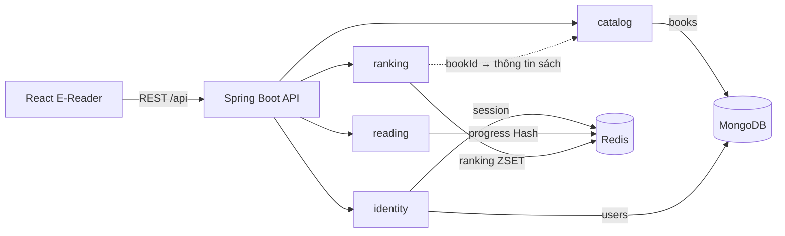

# Dàn ý slide thuyết trình — Đề tài 15: Thư viện số (Polyglot Persistence)

> **Bản 2 — sửa ngày 30/10/2026** sau khi chạy thêm benchmark trên bản sao dữ liệu thật. Bản 1 (29/10) xem ở commit `93503a6`. Danh sách sửa đổi ở [mục cuối](#đối-chiếu-bản-1--bản-2).
> Bản nháp nội dung để nắm ý trước khi dựng slide. Mỗi slide gồm: **Trên slide** (chữ hiện lên màn hình, giữ ngắn), **Hình** (minh họa nên dùng), **Lời nói** (ý cần trình bày), người nói và thời gian.
> Tổng ≈ 11 phút + demo. Thứ tự slide bám theo barem để giám khảo dễ đối chiếu.
> Số liệu lấy từ [ARCHITECTURE.md](../ARCHITECTURE.md), [SHARED.md](../SHARED.md), [DEMO_SCRIPT.md](../DEMO_SCRIPT.md) và [bench_out_real/](../../scripts/seed/bench_out_real/).

| # | Slide | Barem | Người nói | Thời gian |
|---|---|---|---|---|
| 1 | Tiêu đề & nhóm | – | Vũ | 0:30 |
| 2 | Bài toán | 1.0đ | Vũ | 1:00 |
| 3 | Kiến trúc tổng thể | 1.0đ | Vũ | 1:30 |
| 4 | Vì sao Polyglot | 1.0đ | Vũ | 1:30 |
| 5 | Thiết kế MongoDB | 1.5đ | Vũ | 1:30 |
| 6 | Thiết kế Redis | 1.5đ | Đạt | 1:00 |
| 7 | CRUD nền tảng | 2.5đ | Vũ | 1:00 |
| 8 | Tính năng nâng cao | 2.5đ | Đạt | 1:30 |
| 9 | Dữ liệu mẫu & hiệu năng | 1.0đ | Sơn | 1:00 |
| 10 | Demo & kết luận | 1.5đ | Sơn | 0:30 → demo |

---

## Slide 1 — Thư viện số & Đọc sách trực tuyến

**Trên slide**
- Đề tài 15 — Hệ thống thư viện số và đọc sách trực tuyến
- Polyglot Persistence: **MongoDB + Redis**
- Vũ — SV1 Data Architect & CRUD Lead
- Đạt — SV2 Advanced Query Specialist (Redis)
- Sơn — SV3 Fullstack Integrator & DB Tester

**Hình:** ảnh chụp trang Kho sách làm nền mờ.

**Lời nói:** Giới thiệu đề tài trong một câu: cổng đọc sách online cho phép quản lý kho sách, lưu chỗ đọc dở và xem sách thịnh hành. Giới thiệu nhanh vai trò ba người, mỗi người sẽ trình bày đúng phần mình làm.

---

## Slide 2 — Bài toán: ba loại dữ liệu khác nhau

**Trên slide**

| Dữ liệu | Cách truy cập | Cần gì |
|---|---|---|
| Sách → chương → mục, độc giả | Ghi ít, đọc nhiều, văn bản lớn, lồng nhau | Bền vững, truy vấn, index |
| Tiến trình đọc (chương, trang, dòng) | Ghi mỗi lần lật trang | Độ trễ thấp, ghi đè từng field |
| Lượt đọc & bảng xếp hạng | Tăng điểm liên tục, đọc Top N | Luôn có thứ tự, realtime |

→ **Không có một CSDL nào tối ưu cho cả ba.**

**Hình:** ba icon (sách / dấu trang / cúp) tương ứng ba dòng.

**Lời nói:** Đây là câu hỏi gốc của đồ án. Nội dung sách là tài sản lâu dài, có cấu trúc cây. Tiến trình đọc thì ghi rất dày: mỗi lần lật trang là một lần ghi. Bảng xếp hạng thì cần luôn được sắp xếp sẵn. Ba yêu cầu này kéo về ba hướng khác nhau, nên nhóm chọn kết hợp hai CSDL.

---

## Slide 3 — Kiến trúc tổng thể

**Trên slide**
- React (Vite) → REST `/api` → Spring Boot
- Backend chia 4 domain: `catalog`, `identity`, `reading`, `ranking`
- MongoDB: `books`, `users`
- Redis: `progress:*`, `ranking:books`, `session:*`
- **Hai CSDL chỉ liên kết qua ID** (`bookId`, `userId` = ObjectId)

**Hình:** sơ đồ luồng ở ARCHITECTURE mục 1.5 (render mermaid thành ảnh):



**Lời nói:** Mỗi domain chỉ làm việc với dữ liệu của mình, domain khác muốn dùng thì gọi qua service. Điểm quan trọng: Redis **không** chép tiêu đề hay nội dung sách, chỉ giữ ID. Sửa tên sách trong MongoDB thì không phải đồng bộ gì sang Redis. Hạ tầng dựng bằng Docker Compose, kèm Compass và Redis Insight để quan sát.

---

## Slide 4 — Vì sao Polyglot Persistence (1.0đ)

**Trên slide**

| Tiêu chí | Chỉ MongoDB | Chỉ Redis | Mongo + Redis |
|---|---|---|---|
| Lưu cây sách/chương | Tốt | Kém, tốn RAM | Tốt |
| Ghi tiến trình mỗi lần lật trang | Tốn I/O đĩa | Rất tốt | Rất tốt |
| BXH realtime | `$inc` + sort | `ZINCRBY`/`ZREVRANGE` | Rất tốt |

**Đánh đổi & cách xử lý**
- Redis tắt đột ngột → bật **AOF**, mất tối đa ~1 giây ghi
- Không có transaction giữa 2 CSDL → xóa sách/độc giả phát **event** để dọn key Redis

**Lời nói:**
- MongoDB hợp nội dung vì document model lưu nguyên cây sách, có `$jsonSchema`, text index và cập nhật được một phần mảng lồng nhau.
- Redis hợp trạng thái vì chạy trong bộ nhớ, Hash ghi đè đúng field cần đổi, còn ZSET tự giữ thứ tự.
- Nói rõ cái giá phải trả: phải vận hành hai hệ thống, và hai bên chỉ nhất quán sau cùng (eventual). Với lượt đọc "thịnh hành" thì lệch vài lượt vẫn chấp nhận được.

---

## Slide 5 — Thiết kế MongoDB (1.5đ – phần 1)

**Trên slide**
- Database `digital_library`, 2 collection: `books`, `users`
- `books`: **embed** `chapters[]` → `sections[]`
- Lý do embed: luôn đọc cùng nhau; 5–10 chương ≈ 1 MB, xa giới hạn 16 MB; cập nhật nguyên tử trên một document
- `$jsonSchema` với `validationLevel: strict`: ghi sai schema bị **từ chối** kể cả từ Compass
- Index: text `{title, author}`, multikey `categories`, `createdAt`, unique `username`/`email`

**Hình:** sơ đồ ERD (ARCHITECTURE mục 2.1) **+** ảnh Compass mở một document sách. Trích 5–6 dòng schema:

```json
"required": ["title", "author", "categories", "chapters", "createdAt"],
"chapterNo": { "bsonType": ["int", "long"], "minimum": 1 }
```

**Lời nói:** Giải thích vì sao embed thay vì tách bảng như SQL: mở chương không cần JOIN. Embed nhưng không trả toàn văn bừa bãi: danh sách dùng projection bỏ nội dung, đọc một chương dùng `$elemMatch`. Nêu luôn khi nào phải tách collection: khi một sách vượt 16 MB, quy mô đồ án thì chưa cần. Schema là nguồn sự thật nằm trong code, backend tự áp validator khi khởi động.

---

## Slide 6 — Thiết kế Redis (1.5đ – phần 2)

**Trên slide**

| Key | Kiểu | Nội dung |
|---|---|---|
| `progress:{userId}:{bookId}` | Hash | `chapter`, `page`, `line`, `updatedAt` |
| `ranking:books` | ZSET | member = `bookId`, score = lượt đọc |
| `read-lock:{u}:{b}:{chapter}` | String, TTL 60s | chống đếm lặp |
| `session:{sha256(token)}` | String, TTL 7 ngày | phiên đăng nhập |

```redis
HSET progress:<u>:<b> chapter 3 page 30 line 0 updatedAt ...
HGETALL progress:<u>:<b>
ZINCRBY ranking:books 1 <bookId>
ZREVRANGE ranking:books 0 9 WITHSCORES
```

**Hình:** ảnh Redis Insight với cây key nhóm theo `progress:` / `ranking:`.

**Lời nói:** Key đặt dạng `domain:id` để Insight tự nhóm thành thư mục. `ZINCRBY` là phép tăng **nguyên tử** trên Redis, không đọc rồi cộng trong Java, nên nhiều người đọc cùng lúc không bị mất điểm. Session chỉ lưu bản băm của token, nên nhìn vào Redis cũng không lấy được token dùng được.

---

## Slide 7 — CRUD nền tảng (2.5đ)

**Trên slide**
- **Sách:** danh sách (phân trang, lọc thể loại, tìm không dấu), chi tiết, thêm/sửa/xóa
- **Chương:** thêm / sửa / xóa chương trong sách
- **Độc giả:** đăng ký, đăng nhập/đăng xuất, sửa, xóa; đổi mật khẩu thu hồi mọi phiên
- Phân quyền: công khai / `@Authenticated` / `@AdminOnly` → 401, 403
- Lỗi thống nhất `{code, message}`

| Nghiệp vụ | Lệnh MongoDB |
|---|---|
| Thêm chương | `$push` + `$sort`, điều kiện `$ne` chống trùng số chương |
| Sửa chương | `$set: {"chapters.$": c}` |
| Xóa chương | `$pull` |
| Đọc một chương | projection `$elemMatch` |

**Hình:** ảnh màn hình quản trị sách / form thêm chương.

**Lời nói:** Nhấn vào các thao tác trên **mảng lồng nhau**: thêm chương không ghi lại cả cuốn sách, MongoDB đảm bảo nguyên tử ở mức document. Có test tự động cho controller và smoke test API đầy đủ (56 test backend đạt trên Mongo/Redis thật).

---

## Slide 8 — Tính năng nâng cao (2.5đ)

**Trên slide**

**① Lưu tiến trình đọc — Redis Hash**
- Lật trang / đóng tab → `PUT /api/progress/{u}/{b}` → `HSET`
- Mở lại sách → `GET` → `HGETALL` → tự cuộn tới **đúng trang, đúng dòng**
- Trang đánh số liên tục cả cuốn (~45 trang/sách) → mốc **Trang 30** đạt

**② Bảng xếp hạng — Redis ZSET**
- Mở chương → `POST /api/books/{id}/read?chapterNo=` → `ZINCRBY`
- Chống lặp: 1 điểm / tài khoản / sách / chương / 60 giây
- `GET /api/ranking?top=10` → `ZREVRANGE` → ghép thông tin sách từ MongoDB (`/books/batch`)

**Hình:** hai sơ đồ tuần tự nhỏ (React → API → Redis) cạnh nhau.

**Lời nói:** Đây là hai tính năng đặc trưng của đề tài. Với tiến trình: lưu theo từng tài khoản, chỉ chính chủ hoặc admin đọc được, và có xử lý trường hợp đóng tab khi request đang gửi. Với BXH: giải thích vì sao có khóa 60 giây, để F5 liên tục không thổi phồng lượt đọc. Lưu ý cách ghép: Redis trả `bookId` + điểm, còn tiêu đề và tác giả lấy từ MongoDB, đúng nguyên tắc "chỉ liên kết qua ID".

---

## Slide 9 — Dữ liệu mẫu & đo hiệu năng

**Trên slide**

**Dummy data** (`scripts/seed/`, chạy lặp được, ID cố định)
- MongoDB: **60 sách × 5–10 chương** (469 chương, ~3,2 triệu ký tự), 10 thể loại
- Redis: **60 Hash** tiến trình, **1 ZSET 50 sách**, 10 độc giả mẫu

**Benchmark — đo 2 lần, 2 máy, 1000 mẫu/CSDL** (trung vị, ms)

| Thao tác | Lần 1 — dữ liệu dựng riêng | Lần 2 — **bản sao dữ liệu thật** |
|---|---|---|
| Đọc tiến trình | 0,802 / 1,059 → **1,32x** | 0,168 / 0,257 → **1,53x** |
| Ghi tiến trình | 0,831 / 1,114 → **1,34x** | 0,175 / 0,261 → **1,49x** |
| Tăng lượt đọc | 0,837 / 1,148 → **1,37x** | 0,167 / 0,263 → **1,57x** |
| Lấy Top 10 | 0,790 / 1,031 → **1,30x** | 0,223 / 0,343 → **1,54x** |

*(Redis / MongoDB → tỷ lệ. Lần 2 có thêm: đọc 1 chương toàn văn từ MongoDB = 0,262 ms)*

**Hình:** biểu đồ cột đôi 4 thao tác (dùng số lần 2), hoặc 2 nhóm cột cạnh nhau để thấy tỷ lệ giãn ra.

**Lời nói:** Dữ liệu vượt định mức đề bài. Về hiệu năng, nhóm đo hai lần nên **nói rõ cả hai**, đó là điểm mạnh chứ không phải mâu thuẫn:

- Lần 1 đo trên bộ dữ liệu dựng riêng trong database rỗng → Redis nhanh hơn ~1,3 lần.
- Lần 2 nhân bản nguyên dữ liệu đang chạy (62 sách, 4,83 MB toàn văn, 66 tiến trình, ZSET 51 sách) sang vùng cách ly rồi đo lại → Redis nhanh hơn **~1,5 lần**.

Lần 2 sinh ra vì lần 1 có một điểm yếu: MongoDB được đo trong database gần như trống, thuận lợi hơn thực tế. Khi cho Mongo làm việc cạnh toàn văn sách thật thì khoảng cách **rộng ra**, đúng hướng dự đoán.

Nhưng vẫn trình bày trung thực: tỷ lệ 1,5 lần không phải con số để quảng cáo. Ở thang dưới 1 ms, phần lớn thời gian mỗi lệnh là round-trip loopback và overhead driver — chi phí này cộng vào cả hai bên nên **nén** tỷ lệ lại. Bằng chứng: máy chạy lần 2 nhanh hơn khoảng 4 lần về số tuyệt đối, chi phí cố định nhỏ đi, và tỷ lệ tăng từ 1,3x lên 1,5x.

Lý do kiến trúc chọn Redis **không** nằm ở con số này, mà ở chỗ: (1) mỗi lần lật trang là một lần ghi, không nên dồn tải ghi đó lên CSDL đang phục vụ nội dung; (2) ZSET là cấu trúc luôn-đã-sắp-xếp, cập nhật tăng dần thay vì sắp xếp lại khi đọc. Cả hai phép đo đều chạy **một kết nối**, nên chưa đo được lợi thế lớn nhất của Redis là chịu tải ghi đồng thời.

Con số đọc chương toàn văn (0,262 ms, gần bằng đọc một document 4 field) cho thấy MongoDB vẫn khỏe ở đúng việc của nó — nhóm không chọn Redis vì "Mongo chậm".

---

## Slide 10 — Demo & kết luận

**Trên slide**

**Kịch bản demo**
1. Vũ đọc tới **Trang 30** → đóng trình duyệt → mở lại → tự về Trang 30 (Redis Hash)
2. Đạt mở lần lượt chương 1 → 2 → 3 → Sơn refresh Redis Insight: điểm ZSET tăng, BXH **nhảy hạng**

**Kết luận**
- MongoDB giữ nội dung, Redis giữ trạng thái: mỗi CSDL làm đúng việc của nó
- Hướng mở rộng: write-behind tiến trình về MongoDB; tách `chapters` khi sách quá lớn; đo tải đồng thời

**Hình:** ảnh E-Reader có dòng "Tiếp tục từ trang 30…" và tab Thịnh hành.

**Lời nói:** Chuyển nhanh sang demo sống, không giải thích lại những gì demo sẽ cho thấy. Nếu còn thời gian, nhắc một dòng về phần giao diện bổ sung: cây chương, chế độ đọc nghỉ tay, sách liên quan, đề xuất sách.

---

## Chuẩn bị câu hỏi phản biện

| Câu hỏi có thể gặp | Ý trả lời |
|---|---|
| Sao không dùng mỗi MongoDB cho đơn giản? | Làm được, nhưng mỗi lần lật trang là một lần ghi có journal lên CSDL đang phục vụ nội dung; BXH phải `$inc` rồi sort, hoặc chạy aggregation mỗi lần xem. Redis có sẵn cấu trúc phù hợp. |
| Redis mất dữ liệu thì sao? | Bật AOF, mất tối đa ~1 giây. Tiến trình và lượt đọc là dữ liệu chấp nhận mất một phần; nội dung sách nằm an toàn ở MongoDB. |
| Xóa sách thì dữ liệu Redis xử lý thế nào? | MongoDB xóa trước; event `BookDeletedEvent` → `ZREM` khỏi BXH và xóa `progress:*:{bookId}` bằng `SCAN` (không dùng `KEYS`). Redis lỗi thì `/books/batch` bỏ qua id không tồn tại. |
| Sao embed chương mà không tách collection? | Chương luôn đọc cùng sách, số lượng có giới hạn, ~1 MB/sách so với giới hạn 16 MB, cập nhật nguyên tử. Vượt 16 MB thì sẽ tách. |
| Benchmark chỉ 1,3–1,5x, có đáng không? | Đã giải thích ở slide 9: chi phí cố định nén tỷ lệ; lợi thế thật là tách tải ghi và cấu trúc luôn sắp sẵn. Thêm bằng chứng: máy nhanh hơn → chi phí cố định nhỏ hơn → tỷ lệ giãn từ 1,3x lên 1,5x. |
| Sao hai lần đo ra hai con số khác nhau? | Hai máy, hai hệ điều hành, hai bộ dữ liệu. Lần 1 dữ liệu dựng riêng trong DB rỗng; lần 2 nhân bản dữ liệu thật nên Mongo phải làm việc cạnh 4,83 MB toàn văn. Cả hai đều cùng kết luận Redis nhanh hơn, chỉ khác biên độ. |
| Đo trên dữ liệu thật thì có làm hỏng dữ liệu demo không? | Không. Script chỉ **đọc** bằng `SCAN`/`find`, ghi sang database `digital_library_bench_real` và key tiền tố `benchreal:`, dọn sạch khi xong. Đã chụp SHA-256 trạng thái trước/sau, hai lần bằng nhau. Không dùng `FLUSH`. |
| Số liệu có kiểm chứng được không? | Có. File raw 9000 dòng, tính lại thống kê từ raw ra đúng bảng tổng hợp. Mở được tại chỗ. |
| Chống spam lượt đọc thế nào? | Khóa `read-lock:{u}:{b}:{chapter}` TTL 60s, gọi lặp không gia hạn khóa. |
| Bảo mật tiến trình? | Bearer token; không tin `userId` trên URL, chỉ chính chủ hoặc admin; token chỉ lưu dạng băm SHA-256. |

## Checklist trước giờ bảo vệ

- [ ] `docker compose ps`: mongodb, redis healthy
- [ ] Nạp lại dữ liệu tiến trình theo cách chia trang mới
- [ ] Mở sẵn Compass, Redis Insight (key `ranking:books`), web E-Reader
- [ ] Tài khoản và sách cố định cho từng kịch bản
- [ ] Video demo dự phòng
- [ ] Mở sẵn `bench_out_real/bench-real-summary.md` phòng khi giám khảo đòi xem số gốc

---

## Đối chiếu bản 1 → bản 2

Bản 1 viết ngày 29/10/2026 chỉ có số liệu của lần đo thứ nhất. Ngày 30/10/2026 nhóm chạy thêm benchmark trên bản sao dữ liệu thật, nên slide 9 và phần phản biện được sửa lại.

| Chỗ | Bản 1 (29/10) | Bản 2 (30/10) | Lý do sửa |
|---|---|---|---|
| Slide 9, bảng benchmark | 1 cột số, tỷ lệ 1,30–1,37x | 2 cột: lần 1 và lần 2, tỷ lệ 1,49–1,57x | Có thêm phép đo trên dữ liệu thật |
| Slide 9, lời nói | "chỉ khoảng 1,3 lần" | Nêu cả hai lần đo và giải thích vì sao tỷ lệ giãn ra | Chênh lệch giữa hai lần là bằng chứng ủng hộ lập luận, không phải mâu thuẫn cần giấu |
| Slide 9, số liệu mới | – | Thêm đọc 1 chương toàn văn = 0,262 ms | Chứng minh MongoDB vẫn khỏe ở đúng việc của nó |
| Phản biện | 1 câu về benchmark | 4 câu: tỷ lệ, vì sao hai con số, an toàn dữ liệu, kiểm chứng | Đây là chỗ dễ bị hỏi vặn nhất |
| Checklist | – | Thêm dòng mở sẵn file số liệu gốc | – |

**Không đổi:** slide 1–8 và slide 10 giữ nguyên; phân vai và thời lượng giữ nguyên.

**Cảnh báo khi trình bày:** đừng gộp hai lần đo thành một con số trung bình. Hai lần chạy trên hai máy khác nhau, lấy trung bình là sai về phương pháp. Cách trình bày đúng là nêu từng lần kèm điều kiện của nó.

---

## Phụ lục — dữ liệu benchmark đã xuất

### Lần 2 (30/10/2026) — bản sao dữ liệu thật

Thư mục [scripts/seed/bench_out_real/](../../scripts/seed/bench_out_real/): `bench-real-raw.csv` (9000 dòng), `bench-real-summary.json`, `bench-real-summary.md`.

**Môi trường:** macOS 15.7.4 (arm64), Redis 7.4.10 (appendonly=yes), MongoDB 7.0.39, Python 3.11.9. 1000 mẫu/CSDL, warm-up 200, seed 2026, concurrency 1, xen kẽ ngẫu nhiên thứ tự hai CSDL từng cặp.

**Dữ liệu:** bản sao của 62 sách (4,83 MB toàn văn, giữ nguyên index), 12 độc giả, 66 Hash tiến trình, ZSET 51 sách.

| Phép đo | CSDL | n | Trung bình | Trung vị | p95 | p99 | Max |
|---|---|---|---|---|---|---|---|
| read_progress | redis | 1000 | 0,172 | 0,168 | 0,204 | 0,304 | 1,032 |
| read_progress | mongo | 1000 | 0,259 | 0,257 | 0,294 | 0,371 | 1,250 |
| write_progress | redis | 1000 | 0,174 | 0,175 | 0,215 | 0,283 | 0,846 |
| write_progress | mongo | 1000 | 0,259 | 0,261 | 0,298 | 0,528 | 1,073 |
| ranking_incr | redis | 1000 | 0,175 | 0,167 | 0,231 | 0,490 | 1,276 |
| ranking_incr | mongo | 1000 | 0,274 | 0,263 | 0,384 | 0,664 | 1,630 |
| ranking_top10 | redis | 1000 | 0,291 | 0,223 | 0,668 | 1,170 | 2,231 |
| ranking_top10 | mongo | 1000 | 0,475 | 0,343 | 1,153 | 1,925 | 10,441 |
| read_chapter | mongo | 1000 | 0,265 | 0,262 | 0,297 | 0,327 | 0,376 |

Đơn vị ms. Script: [scripts/seed/bench_latency_real.py](../../scripts/seed/bench_latency_real.py).

**Kiểm chứng:** tính lại trung bình, trung vị và p95 từ 9000 dòng raw cho ra đúng bảng trên. Trạng thái dữ liệu thật trước và sau khi chạy có cùng SHA-256 `07b49cb6…`, không còn key `benchreal:*`, database bản sao đã xóa.

### Lần 1 (26/10/2026, Sơn) — dữ liệu dựng riêng

Thư mục [scripts/seed/bench_out/](../../scripts/seed/bench_out/). Windows 10, Redis 7.4.11, MongoDB 7.0.45. 50 vị trí dựng bằng công thức trong database rỗng. Script: [scripts/seed/bench_latency.py](../../scripts/seed/bench_latency.py).

| Phép đo | Trung vị Redis | Trung vị Mongo | p95 Redis | p95 Mongo | Tỷ lệ |
|---|---|---|---|---|---|
| read_progress | 0,802 | 1,059 | 1,273 | 1,870 | 1,32x |
| write_progress | 0,831 | 1,114 | 1,210 | 1,671 | 1,34x |
| ranking_incr | 0,837 | 1,148 | 1,258 | 1,842 | 1,37x |
| ranking_top10 | 0,790 | 1,031 | 1,033 | 1,341 | 1,30x |

### Lần sơ bộ (22/10/2026, Đạt)

Thư mục [docs/dat/evidence/acceptance/benchmark/](../dat/evidence/acceptance/benchmark/). Windows 11, i5-12500H, chỉ đo đọc tiến trình: Redis trung vị 0,533 ms, MongoDB 0,900 ms → 1,69x. Có file `raw-summary-check.json` tự đối chiếu raw với summary.

**Lưu ý:** ba lần đo trên ba máy khác nhau. Chỉ so tỷ lệ trong cùng một lần, không so số tuyệt đối giữa các lần.
